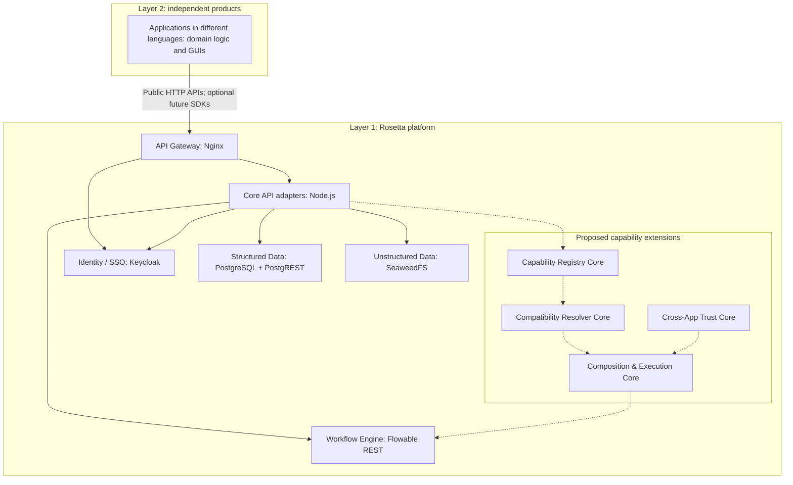

# Rosetta DX-OS

A headless platform for independent applications and verifiable capability composition.

Rosetta is an open-source Layer-1 platform as a service (PaaS). It provides reusable identity, gateway, data and workflow services for Layer-2 products written in different programming languages. Its proposed capability-driven extensions would let authorized applications discover and compose each other's explicitly defined capabilities, with deterministic validation before execution. Authorized AI agents are also proposed as future consumers, subject to the same contracts, validation and trust rules.

The five foundational Cores are implemented and tested in a local Docker Compose stack. Capability-driven extensions remain proposals. The repository currently contains no Layer-2 GUI, SDK or AI integration.

[Architecture](#layer-1-and-layer-2) · [Quickstart](#quickstart) · [API usage](#core-api-usage) · [Status](#implementation-status) · [Roadmap](#development-roadmap) · [Documentation](#documentation-and-self-hosting)

## The problem

Independent products often repeat the same identity, authorization, storage and workflow integration work. Sharing infrastructure alone also leaves teams with application-specific connections: one product needs another's function, but its inputs, permissions and execution conditions are not described consistently.

Rosetta addresses the infrastructure work through a reusable Core. Its longer-term direction is to make application capabilities discoverable and composable through explicit contracts, while each product retains its own domain logic and lifecycle.

## Vision and objectives

The project direction is **Capability-Driven DX-OS**, centered on **Verifiable Capability Composition**. The objectives are to:

- Support independent products through public APIs, regardless of their language.
- Let products use the foundational Cores without adopting capability composition.
- Define discoverable, versioned capabilities with explicit inputs, outputs, authorization requirements and execution conditions.
- Validate relevant compatibility and permissions before composing capabilities, and enforce authorization again during execution.
- Keep business decisions in Layer 2 and reusable platform mechanisms in Layer 1.
- Support self-hosting with documented contracts and open-source infrastructure.

These objectives describe the direction of the project. The [implementation status](#implementation-status) distinguishes current evidence from planned work; [PROJECT_VISION.md](docs/PROJECT_VISION.md) explains the proposals and unresolved design decisions.

## Layer 1 and Layer 2

Layer 1 owns generic infrastructure and, in the proposed architecture, platform-level capability discovery, validation, composition and trust enforcement. Layer 2 owns product interfaces, domain rules and application-specific capabilities. A GUI belongs to an application; a provider's administration console does not make the Rosetta Core a GUI product.



The solid Layer-1 paths represent current integrations. The application box shows intended consumers; dashed paths and the four capability extensions are proposed. "Core" describes a platform boundary, not a requirement for one container per Core. Current adapters share a small Node.js service and delegate infrastructure functions to upstream projects. See [architecture boundaries](docs/ARCHITECTURE.md) for current networks, data ownership and service relationships.

Public contracts reduce coupling to providers. Replacing a provider can still require data migration, identity mapping, workflow conversion and compatibility testing; provider interchangeability is not guaranteed.

## Five foundational Cores

| Core | Current implementation | Public responsibility |
| --- | --- | --- |
| Identity / SSO | Keycloak OIDC, live token introspection and Core authorization | Authenticate users/service accounts; enforce verified tenant membership and reader/writer roles. |
| API Gateway | Nginx OSS with auth-request, rate limits and bounded requests | Provide one local entry point and route authenticated Core calls. |
| Structured Data | PostgreSQL + private PostgREST, versioned SQL migrations | Store generic JSON records in named collections with enforced tenant row-level security (RLS). |
| Unstructured Data | SeaweedFS OSS behind the Core object adapter | Store opaque binary objects under tenant-scoped UUIDs with authorized reads and writes. |
| Workflow Engine | Private Flowable REST with PostgreSQL persistence | Expose tenant-scoped definitions, execution/history, completion and cancellation, with an idempotency ledger. |

These are the five foundational capabilities in the project requirements. Application-specific schemas, approval rules and business workflows belong in Layer 2. The included BPMN checkpoint is a technical test fixture with one user task, not a business application.

## Four proposed capability Cores

| Proposed Core | Intended responsibility | Status |
| --- | --- | --- |
| Capability Registry Core | Publish and discover versioned capability descriptions, input/output contracts, permission requirements and execution conditions. | Proposal; no registry API or service. |
| Compatibility Resolver Core | Check whether selected contracts and composition constraints are compatible; report incompatible or unproven connections. | Proposal; no resolver implementation. |
| Composition & Execution Core | Validate a composition plan, bind authorized inputs and coordinate execution through the underlying Workflow Engine. | Proposal; no composition runtime. |
| Cross-App Trust Core | Define and enforce which applications may publish, discover, invoke or delegate capabilities within an explicit trust scope. | Proposal; current tenant/role checks do not implement cross-app delegation. |

These extensions are Rosetta's proposed product direction, not additional claims about mandatory competition requirements. Their API contracts and security model need review before implementation.

## Verifiable Capability Composition

In the proposed flow, a capability is an application-published operation with an explicit contract and execution conditions. A composition connects authorized capabilities through a plan that the platform can check:

1. An application publishes a capability description and versioned input/output contract, including permissions and execution conditions.
2. An authorized caller discovers capabilities permitted within its trust scope.
3. A caller, application or optional future AI planner proposes a composition.
4. The Core checks relevant schema compatibility, permissions, tenant/trust scope and workflow constraints. Unproven requirements must be resolved or rejected.
5. An accepted plan is executed through the Workflow Engine. Service boundaries validate actual inputs and authorization at runtime.
6. Execution results and failures are checked against the declared contracts and recorded for inspection under the applicable access rules.

Composition coordinates capabilities; the Workflow Engine remains responsible for durable workflow execution. Preflight checks cannot prove business correctness or guarantee that external services will succeed. Runtime authorization remains necessary when permissions or conditions change. An AI proposal grants no extra authority and cannot bypass deterministic validation. This flow is a design proposal, not a description of endpoints available today.

## Language-independent integration

Current clients use HTTP, JSON, OIDC and opaque binary uploads. They can use their language's HTTP and authentication libraries without adopting the Core's Node.js runtime or accessing provider databases directly.

[CORE_API.md](docs/CORE_API.md) is the current human-readable contract for working services. A [design-only extension OpenAPI draft](docs/contracts/capability-api-v1.openapi.json) now specifies proposed capability APIs; those endpoints are not implemented and this draft does not describe the five existing Core APIs. A complete foundational OpenAPI contract, runtime conformance checks and optional language-specific SDKs remain planned. Future SDKs should wrap public APIs and remain optional for interoperability.

## Illustrative cross-application use case

Consider an independently developed intake application and a review application, possibly written in different languages. The intake application stores a binary attachment and its metadata through Rosetta. In a future capability-enabled system, it could publish a `submit-for-review` capability with a versioned request schema and explicit permission requirements. The review application could expose `record-review-result` with its own contract.

An authorized caller could propose a composition connecting those operations. Rosetta would check the declared schemas, trust scope and execution constraints before coordinating the accepted plan through the Workflow Engine. Each application would still own its submission and review rules. An optional AI planner could suggest the connection, subject to the same checks as a human-authored plan.

This example is illustrative. Neither application nor its capabilities is included. The current integration suite exercises a technical record/object/workflow flow; it does not prove capability discovery or automated composition.

## Implementation status

"Implemented" means source/configuration exists; "verified" identifies runnable checks. Planned features have no corresponding implementation evidence yet.

| Area | Implementation | Verification or next step |
| --- | --- | --- |
| Five foundational Cores | Implemented in the local Compose stack. | Real-service tests cover OIDC PKCE/login/logout, authenticated routing, data/object CRUD and workflow lifecycle. |
| Tenant isolation and input limits | Implemented in adapters and database RLS. | Tests cover foreign IDs, spoofed tenant headers, read-only roles, malformed/oversized requests and direct SQL RLS. |
| Workflow retry handling | Implemented with a tenant-scoped SQL reservation and history reconciliation. | Tests cover replay, input conflicts, concurrent starts and ambiguous outcome reconciliation; no exactly-once claim for external business effects. |
| Dependency failure and persistence | Implemented liveness/readiness and named volumes. | Tests interrupt/recreate services and verify stored records, object bytes and workflow state. |
| Structured-data restore | Isolated `pg_dump`/`pg_restore` test implemented. | Restored data and tenant RLS verified; full-platform disaster recovery remains unverified. |
| CI and source licensing | GitHub Actions and approved Apache-2.0 project licensing in place. | CI runs source/unit/container/integration/restore checks; binary redistribution and vulnerability audits remain separate work. |
| Four capability extensions and composition | Proposed. | Review contracts, deterministic validation, trust/delegation and execution semantics before coding. |
| OpenAPI and optional SDKs | Extension design draft available; foundational OpenAPI and SDKs planned. | Review the proposed contracts and prove runtime conformance before generating clients. |
| Layer-2 GUI and optional AI planning | Future work; no implementation here. | Build separately against public contracts; an AI integration needs its own approved scope. |
| VPS/public-domain deployment | Future operational work. | Approve a target and verify TLS, secrets, backups and rollback. No public demo is configured. |

## Quickstart

### Prerequisites

- Git and Node.js 24; the target runtime is recorded in [.node-version](.node-version).
- Docker Engine with Linux containers and Docker Compose v2.20 or newer. On Windows, start Docker Desktop's Linux engine before running Compose.
- Network access to fetch the pinned upstream images and sufficient local resources to run PostgreSQL, Keycloak, Flowable and the other services.

There are no npm dependencies, package installation or transpilation steps. A VPS, public domain, Kubernetes and OpenStack are not required.

### Start the local platform

```sh
git clone https://github.com/NHMNDaizoken/Rosetta.git
cd Rosetta
npm run setup
docker compose config --quiet
docker compose up --build --detach --wait --wait-timeout 240
npm run healthcheck
docker compose exec -T core node scripts/check-health.mjs
docker compose ps
```

If you already have a checkout, start from its root. `npm run setup` creates an ignored `.env` containing random local fixture credentials and refuses to overwrite an existing file. Preserve an existing `.env` and compare its setting names with [.env.example](.env.example); copying the empty credential template is not a substitute for setup.

The gateway is available at `http://127.0.0.1:8080` by default. This is an API entry point, with no application home page. Only Nginx publishes a host port. Provider ports stay on private Compose networks. Core runs as a nonroot user with a read-only filesystem, dropped capabilities and no Docker socket. PostgreSQL and SeaweedFS persist state in named volumes.

`GET /health` returns `{"service":"rosetta-core","status":"ok"}` for process liveness; `HEAD /health` returns the same status/headers without a body. Other methods return `405`. `GET /ready` returns `200` or `503` based on configured dependencies. A passing health probe alone does not verify the whole platform.

### Configuration and common startup problems

- `PORT` controls the native listening port and Compose's loopback host mapping; the Core container listens on 8080. Keep `PUBLIC_URL` consistent with the gateway URL because Keycloak uses it in its issuer. The PKCE fixture callback is fixed separately in the realm configuration.
- The host `npm run healthcheck` reads `PORT` from the calling shell, not `.env`. For a custom port, use `node --env-file=.env scripts/check-health.mjs`.
- If Docker cannot connect to its daemon, start the Linux engine first. If startup times out, inspect `docker compose ps` and service diagnostics locally. Logs and resolved Compose configuration may contain sensitive information; do not publish them without review. Use `docker compose config --quiet` for validation.
- Editing the Keycloak realm JSON does not migrate an existing realm. Never delete a volume to force configuration changes. Existing database credentials also need coordinated rotation; editing `.env` alone does not rotate stored accounts.

Stop with `docker compose down`. Named volumes remain. Do not use `down -v` or volume pruning on persistent project data. See [local operations](docs/OPERATIONS.md) for startup, migration and recovery boundaries.

For the standalone health process without configured integrations, stop Compose first, run `npm start`, and run `npm run healthcheck` in a second terminal. `HOST` defaults to loopback and `PORT` to 8080; stop with Ctrl+C.

## Core API usage

After Compose is ready, this Node.js example works without an SDK or `jq`. It uses the local tenant-A service account from `.env` and prints only the verified identity:

```sh
node --env-file=.env --input-type=module -e "
const base = process.env.PUBLIC_URL ?? 'http://127.0.0.1:8080';
const issued = await fetch(base + '/identity/realms/rosetta/protocol/openid-connect/token', {
  method: 'POST',
  body: new URLSearchParams({ grant_type: 'client_credentials', client_id: 'tenant-a', client_secret: process.env.TENANT_A_SECRET })
});
if (!issued.ok) throw new Error('Token request failed: ' + issued.status);
const token = (await issued.json()).access_token;
const response = await fetch(base + '/v1/identity', { headers: { Authorization: 'Bearer ' + token } });
if (!response.ok) throw new Error('Identity request failed: ' + response.status);
console.log(await response.json());
"
```

The identity includes `subject`, `tenantId: 'tenant-a'` and supported roles. Tokens and fixture secrets must stay private. Browser applications should use the documented authorization-code + S256 PKCE flow; do not embed service-account secrets in a frontend. Fixture users/clients are local technical accounts, not production onboarding.

| API surface | Available behavior |
| --- | --- |
| `/identity/realms/rosetta/.well-known/openid-configuration` | Standard upstream OIDC discovery and authorization/token/logout endpoints. |
| `GET /v1/identity` | Verified subject, tenant and reader/writer roles. |
| `/v1/data/{collection}` and `/{id}` | List/create/read/update/delete tenant records; JSON body limit 64 KiB. |
| `/v1/objects` and `/{uuid}` | Upload/read/delete opaque bytes; stable-UUID PUT supports retryable replacement, with a 1-byte to 5-MiB upload bound. |
| `/v1/workflows/definitions` and `/v1/workflows/executions` | List operator-installed definitions; start with a UUID idempotency key, inspect, complete one active user task or cancel. |

Versioned `/v1` reads require `core-reader`; writes also require `core-writer`. OIDC discovery and the health/readiness probes are public. The Core derives tenant identity from verified provider claims, never caller-supplied tenant headers. Authentication failures and dependency outages fail closed. Detailed methods, payloads, status codes, limits and retry semantics are in [CORE_API.md](docs/CORE_API.md).

## Integration verification

With the local stack running, execute the suites sequentially:

```sh
npm run check
npm test
npm run test:integration
npm run test:recovery
```

The current suite has 14 unit tests, 8 real-service integration tests and 1 isolated PostgreSQL restore test. Integration checks include two-tenant denials, real PKCE login/logout, concurrent workflow retries and a technical flow linking structured metadata, binary objects and durable workflow state.

The integration suite intentionally interrupts local services, restarts PostgreSQL and recreates containers. Use a development/test stack without application traffic. The recovery suite restores into its own network-isolated temporary PostgreSQL; it does not restore over project data. These checks do not establish coordinated recovery of identity, objects and workflow databases.

[GitHub Actions](https://github.com/NHMNDaizoken/Rosetta/actions/workflows/ci.yml) runs source/license-header checks, native and pinned-container unit tests, a Compose build/start, health probes, integration tests and isolated restore. It stops its test stack afterwards and does not publish images or deploy. The source check verifies syntax and project license conventions; it is not a full license or vulnerability audit of container packages.

## Repository structure

```text
src/                          Core health, authorization and data/object/workflow adapters
infra/keycloak/               Local OIDC realm and fixture client configuration
infra/nginx/                  Gateway routes, authentication and request bounds
infra/postgres/               Database bootstrap and versioned data/ledger migrations
infra/seaweedfs/              Persistent filer metadata configuration
infra/flowable/               Original technical BPMN checkpoint fixture
tests/                        Unit and HTTP contract tests
integration/                  Real-service, restart and isolated restore checks
scripts/                      Setup, source checks, health probe and workflow initializer
docs/                         Vision, architecture, API, operations and project policies
.github/workflows/ci.yml       Verification pipeline
compose.yaml                  Local provider networks, persistence and startup ordering
Dockerfile                    Minimal nonroot Core image
.env.example                  Configuration template without working credentials
AGENTS.md                     Public repository development rules
LICENSE, NOTICE, THIRD-PARTY.md Licensing, attribution and component inventory
```

Application packages, SDK directories and capability services are not scaffolded ahead of implementation.

## Technical stack and attribution

Rosetta's adapters use Node.js 24 and its standard HTTP, crypto and test APIs, with no npm runtime dependencies. Nginx OSS, Keycloak, PostgreSQL/PostgREST, SeaweedFS OSS and Flowable REST supply the foundational infrastructure. Docker Compose provides local self-hosting; GitHub Actions provides verification. Images and Actions are pinned in the configuration.

[THIRD-PARTY.md](THIRD-PARTY.md) records upstream versions/digests, source links, licenses and notice obligations. Upstream projects retain their own copyrights and terms, including bundled operating-system/runtime packages. Container separation does not remove license obligations. Binary redistribution needs its own complete inventory and notice review.

[SynapseDX](https://github.com/vku-open-source-2026/SynapseDX) is a reference for README organization, quickstart presentation and repository practices. Rosetta's capability model and implementation have their own scope; no SynapseDX source or configuration is copied into this project.

## Development roadmap

| Workstream | Current position | Next acceptance evidence |
| --- | --- | --- |
| Foundational Core | Implemented and verified locally. | Maintain API/tenant regression checks and extend operational recovery evidence. |
| Public contracts | Human-readable `/v1` contracts exist. | Add reviewed OpenAPI and compatibility/conformance tests before optional SDKs. |
| Capability publication and trust | Proposed Registry and Cross-App Trust Cores. | Agree versioning, ownership, visibility and invocation/delegation rules; prove denied cases. |
| Verifiable composition | Proposed Resolver and Composition & Execution Cores. | Define supported checks and workflow bindings; test incompatible schemas, revoked permissions, retries and runtime failures. |
| Independent Layer-2 products | No application is implemented. | Demonstrate an application using foundational APIs, then a separately reviewed cross-application capability scenario. |
| Optional AI planning | Aspirational integration. | Validate any planner output through the same deterministic Core checks and authorization. |
| Deployment and release | Local Compose and CI only. | Approve a target; verify TLS/secrets, full backup/restore, rollback, security/license audits and release procedures. |

There are no promised dates or published release milestones in this roadmap. The [foundation integration roadmap](docs/INTEGRATION_ROADMAP.md) retains detailed acceptance criteria and the SynapseDX reference review. Capability extension work requires reviewed contracts and authorization before implementation.

## Contributing, security and licensing

Read [AGENTS.md](AGENTS.md), [architecture boundaries](docs/ARCHITECTURE.md) and the [development workflow](docs/WORKFLOW.md) before changing code. Use the existing `main` branch and cohesive, tested Conventional Commits. Discuss new services, frameworks, breaking contracts and license changes before implementation. Keep domain logic in Layer 2 and add relevant tests and documentation.

Use [GitHub Issues](https://github.com/NHMNDaizoken/Rosetta/issues) for public bugs and design discussions. Do not post credentials, private data or vulnerability exploit details there; arrange a private channel with the repository maintainer before disclosure. No dedicated security contact or response SLA is published. Do not commit `.env`, private agent context, execution logs or local tool state. `AGENTS.md` remains public. Inspect exclusions, indexed files and secret exposure before pushing; never force-push or deploy to production without approval.

Original Rosetta source and documentation are licensed under [Apache License 2.0](LICENSE), with attribution **Copyright 2026 Rosetta Contributors**, subject to contributors' actual rights and agreement. Preserve upstream notices. See [NOTICE](NOTICE), [THIRD-PARTY.md](THIRD-PARTY.md) and the [licensing policy](docs/LICENSING.md). `private: true` in package metadata prevents accidental npm publication; it does not change the project's open-source license.

## Documentation and self-hosting

- [Project vision](docs/PROJECT_VISION.md): capability model, proposed Cores and open design decisions.
- [Capability extensions v1](docs/CAPABILITY_EXTENSIONS_V1.md): draft manifests, lifecycle, ownership and compatibility, with linked trust/execution and OpenAPI contracts.
- [Capability acceptance criteria](docs/CAPABILITY_ACCEPTANCE_V1.md): negative cases, validation recipe and implementation approval gates.
- [Architecture](docs/ARCHITECTURE.md): Layer boundaries, current providers and isolation.
- [Core API contracts](docs/CORE_API.md): routes, permissions, payloads and retry semantics.
- [Local operations](docs/OPERATIONS.md): startup, persistence, migrations and recovery limits.
- [Integration roadmap](docs/INTEGRATION_ROADMAP.md): foundational acceptance criteria and reference review.
- [Development workflow](docs/WORKFLOW.md): verification, handoff and release procedure.
- [Licensing](docs/LICENSING.md): approved project terms and dependency obligations.
- [OLP requirements](docs/OLP_REQUIREMENTS.md): project compliance notes and official references.

Self-hosting currently means the loopback-bound local Compose stack. VPS hosting, a public domain and production operation are future steps, not quickstart prerequisites. No public demo, registry publishing, Kubernetes or OpenStack deployment is provided. The broader project includes a future Layer-2 application; the implemented and verified scope here remains the Layer-1 foundation.
