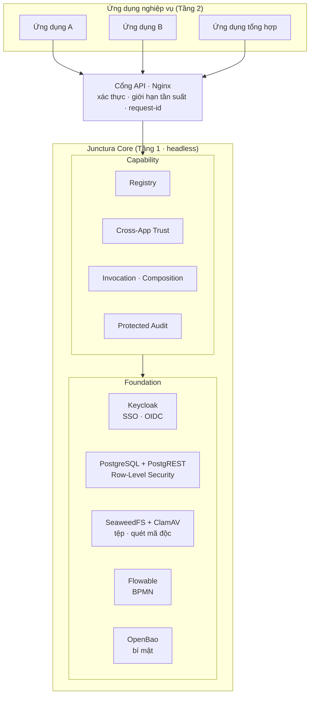
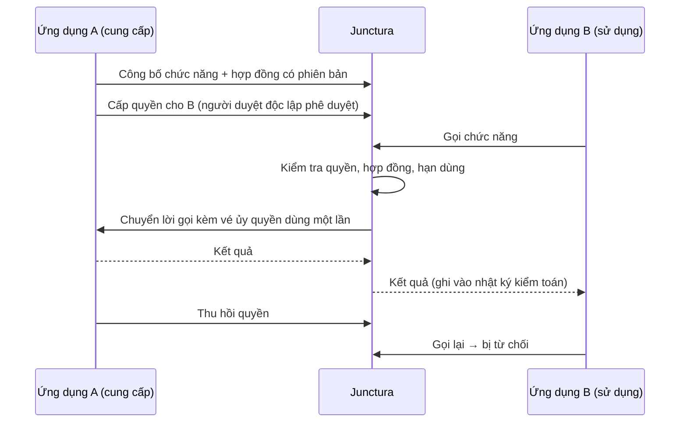

<div align="center">


# Junctura DX-OS

**Nền tảng lõi nguồn mở để các ứng dụng chia sẻ dữ liệu và năng lực với nhau — có cấp quyền, thu hồi và kiểm chứng.**

[](https://github.com/NHMNDaizoken/Rosetta/actions/workflows/ci.yml)
[](CHANGELOG.md)
[](LICENSE)
[](REUSE.toml)

[Bắt đầu nhanh](#bắt-đầu-nhanh) · [Kiến trúc](#kiến-trúc) · [Tài liệu](#tài-liệu) · [English](docs/README_EN.md)

</div>

---

## Giới thiệu

Trong một tổ chức, mỗi phòng ban thường vận hành phần mềm riêng. Mỗi phần mềm tự xây lại đăng nhập, lưu trữ, phân quyền và quy trình duyệt; dữ liệu trở thành những ốc đảo. Khi một ứng dụng cần dữ liệu hay chức năng của ứng dụng khác, người ta lại viết thêm một kết nối riêng — khó kiểm soát ai được dùng gì, đến khi nào.

**Junctura** là tầng nền tảng dịch vụ lõi (headless PaaS) của kiến trúc DX-OS, giải quyết bài toán đó theo hai lớp:

- **Foundation** — những dịch vụ mọi ứng dụng đều cần, xây một lần và dùng chung: định danh/SSO, cổng API, dữ liệu có cấu trúc, lưu trữ tệp và động cơ quy trình.
- **Capability** — mỗi ứng dụng giữ dữ liệu và nghiệp vụ của riêng mình nhưng có thể **công bố chức năng**; ứng dụng khác **được cấp quyền** để gọi; Junctura **kiểm tra, thực thi và ghi vết** từng lần gọi; chủ sở hữu **thu hồi** bất cứ lúc nào.

> *Junctura* — tiếng Latin nghĩa là “mối nối”: nơi các ứng dụng độc lập gặp nhau.

## Tính năng nổi bật

**Nền tảng dùng chung**
- Đăng nhập một lần qua OIDC (Keycloak), vai trò đọc/ghi, cô lập theo tenant.
- Một cổng API duy nhất: xác thực mọi request ngay tại cổng, giới hạn tần suất, gắn request-id.
- Dữ liệu có cấu trúc với phân quyền theo từng dòng (Row-Level Security) cho từng tenant và từng ứng dụng.
- Lưu trữ tệp, mọi tệp được quét mã độc trước khi nhận.
- Quy trình nghiệp vụ BPMN, chống chạy trùng bằng idempotency key.

**Chia sẻ năng lực có kiểm soát**
- Chia sẻ từng bản ghi/tệp cho ứng dụng khác: chỉ đọc, có hạn dùng, thu hồi được.
- Danh mục năng lực (Capability Registry) với hợp đồng đầu vào/đầu ra có phiên bản.
- Cấp và thu hồi quyền giữa các ứng dụng, phê duyệt bởi người độc lập với người yêu cầu.
- Gọi chức năng của ứng dụng khác (C4A) hoặc ghép nhiều chức năng thành một quy trình (C4B).
- Nhật ký kiểm toán được bảo vệ: ứng dụng không thể sửa hay xóa dấu vết.

**Vận hành và phát triển**
- Khởi động toàn bộ hệ thống, đăng ký ứng dụng mới, sao lưu và khôi phục — mỗi việc một lệnh.
- Nhật ký truy cập dạng JSON tại cổng API, truy vết từng request bằng request-id.
- OpenAPI 3.1 cho mọi API, Node SDK không phụ thuộc thư viện ngoài.
- Console quản trị song ngữ Việt/Anh.
- Bí mật quản lý bằng OpenBao; migration cơ sở dữ liệu có checksum chống sửa lén.

## Kiến trúc



Chỉ cổng API mở ra ngoài; mọi dịch vụ khác nằm trong mạng nội bộ. Core chạy không quyền root trên hệ thống tệp chỉ đọc.

### Một lần chia sẻ năng lực diễn ra thế nào



## Bắt đầu nhanh

**Yêu cầu:** Git, Node.js 24, Docker Desktop (Linux engine) với Docker Compose ≥ 2.20. Khuyến nghị RAM 16 GB (dành ≥ 8 GB cho Docker).

```sh
git clone https://github.com/NHMNDaizoken/Rosetta.git junctura
cd junctura
npm run setup        # tạo .env với mật khẩu ngẫu nhiên (không commit)
npm run local:up     # build và khởi động toàn bộ hệ thống
npm run healthcheck  # kiểm tra các dịch vụ đã sẵn sàng
```

| Địa chỉ | Dịch vụ |
| --- | --- |
| `http://127.0.0.1:8080` | Cổng API |
| `http://127.0.0.1:3000` | Junctura Console |

Lần chạy đầu cần tải image và bộ nhận diện mã độc của ClamAV (vài phút). Gặp lỗi: `npm run doctor`. Dừng mà vẫn giữ dữ liệu: `npm run local:down`. Sao lưu: `npm run backup`; khôi phục: `npm run restore -- backups/<thời-điểm> --yes` (xem [Vận hành](docs/OPERATIONS.md#backup-and-restore)).

### Đăng ký ứng dụng đầu tiên

```sh
npm run app:enroll -- daotao --display-name "Phòng Đào tạo"
```

Lệnh tạo tài khoản dịch vụ cho ứng dụng, đăng ký và phê duyệt nó (người duyệt độc lập với người đăng ký), rồi ghi thông tin đăng nhập riêng của ứng dụng vào `.env.app.daotao.local`.

### Gọi API từ ứng dụng

```js
import { createJuncturaClient } from "./sdk/node/index.mjs";

const junctura = createJuncturaClient({
  baseUrl: process.env.JUNCTURA_URL,
  clientId: process.env.JUNCTURA_APP_CLIENT_ID,
  clientSecret: process.env.JUNCTURA_APP_CLIENT_SECRET,
});

const record = await junctura.createRecord("students", { name: "Nguyễn Văn A" });
const same = await junctura.getRecord("students", record.id);
```

Ứng dụng viết bằng ngôn ngữ nào cũng tích hợp được qua HTTP + JSON + OIDC; SDK chỉ là lựa chọn tiện lợi cho Node.js.

## Công nghệ

| Thành phần | Công nghệ |
| --- | --- |
| Định danh, SSO | Keycloak 26 |
| Cổng API | Nginx |
| Dữ liệu có cấu trúc | PostgreSQL 17, PostgREST |
| Lưu trữ tệp | SeaweedFS, ClamAV |
| Quy trình | Flowable 8 (BPMN 2.0) |
| Quản lý bí mật | OpenBao |
| Core, SDK | Node.js 24 (không phụ thuộc npm khi chạy) |
| Console | React, Vite, TypeScript |
| Đóng gói, CI | Docker Compose, GitHub Actions |

Phiên bản chính xác và giấy phép của từng thành phần: [THIRD-PARTY.md](THIRD-PARTY.md).

## Tài liệu

| | |
| --- | --- |
| [Hướng dẫn bắt đầu](docs/GETTING_STARTED.md) | Cài đặt, đăng ký ứng dụng, gọi API, SDK |
| [Kiến trúc](docs/ARCHITECTURE.md) | Ranh giới các tầng, dịch vụ và cách cô lập |
| [Core API](docs/CORE_API.md) · [OpenAPI](docs/contracts/foundation-api.openapi.json) | Route, quyền, payload, quy tắc retry |
| [Capability](docs/CAPABILITY_REGISTRY.md) | Registry, [Trust](docs/CAPABILITY_DIRECT_TRUST.md), [Invocation](docs/CAPABILITY_EXECUTION.md), [Composition](docs/CAPABILITY_COMPOSITION.md) |
| [Kiểm toán](docs/AUDIT.md) · [Bảo mật](docs/SECURITY_REVIEW.md) | Mô hình đe dọa, kết quả quét, vấn đề còn mở |
| [Vận hành](docs/OPERATIONS.md) · [Phát hành](docs/RELEASE.md) | Khởi động, migration, sao lưu, đóng gói |
| [Đối chiếu đề thi OLP'26](docs/OLP_REQUIREMENTS.md) | Yêu cầu của đề và cách Junctura đáp ứng |
| [Mục lục đầy đủ](docs/index.md) | Toàn bộ thiết kế và quyết định kiến trúc |

## Kiểm thử

GitHub Actions chạy ở mỗi lần push: kiểm tra giấy phép SPDX/REUSE, kiểm thử đơn vị, build và khởi động toàn bộ hệ thống, rồi kiểm thử tích hợp với dịch vụ thật — định danh, dữ liệu, tệp, quy trình, chia sẻ năng lực, kiểm toán và khôi phục dữ liệu.

```sh
npm run check && npm test          # kiểm tra mã nguồn và kiểm thử đơn vị
npm run test:integration           # kiểm thử tích hợp (cần hệ thống đang chạy)
```

## Đóng góp

Mọi đóng góp đều được hoan nghênh. Báo lỗi và đề xuất tại [Issues](https://github.com/NHMNDaizoken/Rosetta/issues); trước khi gửi Pull Request, đọc [hướng dẫn phát triển](docs/DEVELOPING.md). Commit theo chuẩn Conventional Commits và không bao giờ commit tệp `.env` hay khóa bí mật. Lịch sử thay đổi: [CHANGELOG.md](CHANGELOG.md).

## Giấy phép

Phát hành theo [Apache License 2.0](LICENSE) — Copyright 2026 Junctura Contributors. Các thành phần bên thứ ba giữ giấy phép riêng; xem [NOTICE](NOTICE) và [THIRD-PARTY.md](THIRD-PARTY.md).
