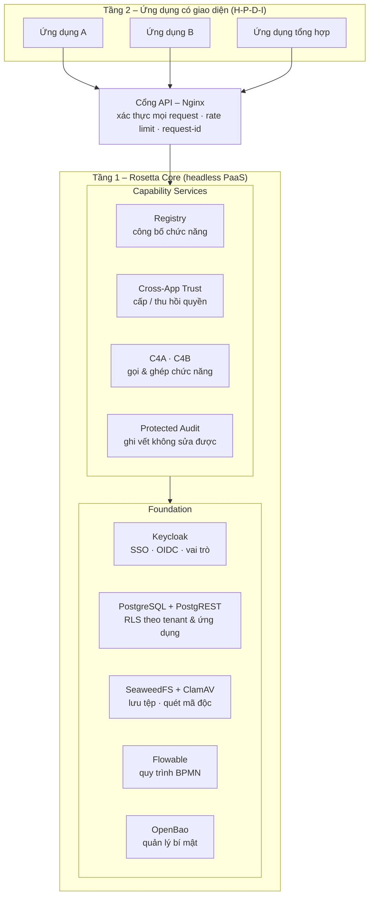

# Rosetta DX-OS

**Nền tảng lõi nguồn mở cho chuyển đổi số — không chỉ chia sẻ hạ tầng, mà chia sẻ _năng lực_ giữa các ứng dụng, có cấp quyền, thu hồi và kiểm chứng được.**

[](https://github.com/NHMNDaizoken/Rosetta/actions/workflows/ci.yml)
[](LICENSE)
[](REUSE.toml)

> Sản phẩm dự thi khối **Phần mềm nguồn mở – Olympic Tin học Sinh viên Việt Nam 2026 (OLP'26)**,
> đề bài *“Xây dựng Hệ điều hành Chuyển đổi số bằng Công nghệ Lõi nguồn mở (DX-OS Open-Core)”*.
> English reference: [docs/README_EN.md](docs/README_EN.md).

## Đội thi

| | |
| --- | --- |
| **Tên đội** | `<Tên đội>` |
| **Trường** | `<Tên trường>` |
| **Thành viên** | `<Họ tên 1>` · `<Họ tên 2>` · `<Họ tên 3>` |
| **Giảng viên hướng dẫn** | `<Học hàm, họ tên>` – `<Khoa/Trường>` |

## Rosetta giải quyết vấn đề gì?

Trong một tổ chức, mỗi phòng ban thường có phần mềm riêng. Phần mềm nào cũng tự làm lại đăng nhập, lưu trữ, phân quyền, quy trình duyệt… và dữ liệu thành các **“ốc đảo”** không thông với nhau. Khi một ứng dụng cần dữ liệu hay chức năng của ứng dụng khác, người ta lại viết thêm một kết nối riêng, khó kiểm soát ai được dùng gì.

Rosetta là **Tầng 1 (nền tảng dịch vụ lõi, headless)** của kiến trúc DX-OS:

1. **Foundation** — cung cấp một lần, dùng chung: định danh/SSO, cổng API, dữ liệu có cấu trúc, lưu trữ tệp và động cơ quy trình.
2. **Capability (điểm khác biệt)** — mỗi ứng dụng Tầng 2 giữ dữ liệu và nghiệp vụ của riêng mình, nhưng có thể **công bố chức năng** lên Rosetta; ứng dụng khác **xin quyền** để gọi, Rosetta **kiểm tra, thực thi, ghi vết** và chủ sở hữu có thể **thu hồi** bất cứ lúc nào.

Giống như *phiến đá Rosetta* giúp các ngôn ngữ hiểu nhau, Rosetta giúp các ứng dụng độc lập “nói chuyện” với nhau một cách an toàn.

## Kiến trúc



Chỉ cổng API mở ra ngoài; mọi dịch vụ còn lại nằm trong mạng nội bộ của Docker. Core chạy không quyền root, hệ thống tệp chỉ đọc.

## Đối chiếu yêu cầu đề thi

| Yêu cầu của đề | Rosetta đáp ứng bằng | Trạng thái |
| --- | --- | --- |
| Định danh, đăng nhập một lần (SSO) | Keycloak (OIDC, PKCE), vai trò `core-reader` / `core-writer` | ✅ |
| Cổng API (API Gateway) | Nginx: một cửa duy nhất, kiểm tra token qua `auth_request`, giới hạn tần suất | ✅ |
| Quản trị dữ liệu có cấu trúc | PostgreSQL + PostgREST, phân quyền theo dòng (RLS), migration có checksum | ✅ |
| Quản trị dữ liệu phi cấu trúc | SeaweedFS, ClamAV quét mã độc trước khi nhận tệp | ✅ |
| Động cơ luồng công việc | Flowable REST (BPMN), chống chạy trùng bằng idempotency key | ✅ |
| Headless – không có giao diện người dùng | Core chỉ cung cấp API; Console là công cụ quản trị tách riêng | ✅ |
| Zero-Trust, an toàn thông tin | Xác thực tại cổng, cô lập tenant/ứng dụng, OpenBao giữ bí mật, audit chống chối bỏ | ✅ |
| Sao lưu & khôi phục | Kiểm thử `pg_dump`/`pg_restore` cô lập, kiểm tra lại RLS và audit sau khôi phục | ✅ |

## Điểm khác biệt: Capability Services

| Thành phần | Làm gì |
| --- | --- |
| **Application Management** | Đăng ký ứng dụng, mỗi ứng dụng sở hữu dữ liệu riêng. |
| **Resource Sharing** | Chủ sở hữu chia sẻ từng bản ghi/tệp cho ứng dụng khác, chỉ đọc, có hạn dùng, thu hồi được. |
| **Capability Registry (C1)** | Ứng dụng công bố chức năng kèm hợp đồng đầu vào/đầu ra có phiên bản. |
| **Cross-App Trust (C2)** | Cấp và thu hồi quyền dùng chức năng giữa các ứng dụng. |
| **Compatibility Resolver (C3)** | Kiểm tra tương thích phiên bản/hợp đồng giữa các chức năng. |
| **Capability Invocation (C4A)** | Ứng dụng B gọi chức năng của ứng dụng A *thông qua* Rosetta. |
| **Capability Composition (C4B)** | Ghép chức năng của nhiều ứng dụng thành một quy trình, chạy trên Flowable. |
| **Protected Audit** | Ghi vết mọi thao tác quan trọng; ứng dụng không thể sửa hay xóa. |

Chi tiết: [Capability Registry](docs/CAPABILITY_REGISTRY.md) · [Trust](docs/CAPABILITY_DIRECT_TRUST.md) · [Execution](docs/CAPABILITY_EXECUTION.md) · [Composition](docs/CAPABILITY_COMPOSITION.md) · [Audit](docs/AUDIT.md).

## Chạy nhanh

**Cần có:** Git, Node.js 24, Docker Desktop (Linux engine) với Docker Compose ≥ 2.20.
**Khuyến nghị máy:** RAM 16 GB (dành ≥ 8 GB cho Docker), ~10 GB ổ đĩa trống. Lần chạy đầu cần mạng để tải image; ClamAV có thể mất đến ~5 phút để tải bộ nhận diện mã độc.

```sh
git clone https://github.com/NHMNDaizoken/Rosetta.git
cd Rosetta
npm run setup        # tạo .env với mật khẩu ngẫu nhiên (không commit)
npm run local:up     # build và khởi động toàn bộ hệ thống
npm run healthcheck  # kiểm tra mọi dịch vụ đã sẵn sàng
```

- Cổng API: `http://127.0.0.1:8080` · Console quản trị: `http://127.0.0.1:3000`
- Gặp lỗi khởi động: `npm run doctor`
- Dừng (giữ nguyên dữ liệu): `npm run local:down`

**Đăng ký một ứng dụng Tầng 2 chỉ bằng một lệnh** (môi trường dev/demo):

```sh
npm run app:enroll -- daotao --display-name "Phòng Đào tạo"
```

Lệnh tạo client Keycloak `app-daotao`, đăng ký và duyệt ứng dụng (người duyệt độc lập với người đăng ký), rồi ghi thông tin đăng nhập riêng của ứng dụng vào `.env.app.daotao.local` (không commit). Chi tiết: [Hướng dẫn bắt đầu](docs/GETTING_STARTED.md).

## Tích hợp cho ứng dụng Tầng 2

Ứng dụng viết bằng ngôn ngữ nào cũng dùng được: chỉ cần HTTP + JSON + OIDC.

- [OpenAPI của Foundation](docs/contracts/foundation-api.openapi.json) (44 thao tác) và [OpenAPI của Capability](docs/contracts/capability-api-v1.openapi.json)
- [Node SDK](sdk/node/index.mjs) không phụ thuộc thư viện ngoài, kèm [ví dụ](examples/sdk-foundation.mjs)
- [Hướng dẫn mở rộng](docs/DEVELOPING.md)

## Chất lượng

- **CI** (GitHub Actions) chạy ở mỗi lần push: kiểm tra SPDX/REUSE, kiểm thử đơn vị, build & khởi động toàn bộ stack, kiểm thử tích hợp với dịch vụ thật (định danh, dữ liệu, tệp, quy trình, capability, composition, audit, khôi phục).
- **Hơn 200 bài kiểm thử** trên các bộ unit, migration, integration, capability, composition, audit, recovery và Console.
- **Migration có checksum**: phát hiện việc sửa lén lịch sử cơ sở dữ liệu.
- **Giấy phép Apache-2.0**, mỗi tệp mã có SPDX header, đạt chuẩn [REUSE](https://reuse.software/).
- Image và GitHub Actions được ghim theo digest; danh sách thành phần bên thứ ba ở [THIRD-PARTY.md](THIRD-PARTY.md).

## Tài liệu chính

| Tài liệu | Nội dung |
| --- | --- |
| [Hướng dẫn bắt đầu](docs/GETTING_STARTED.md) | Cài đặt, đăng ký ứng dụng, gọi API đầu tiên |
| [Kiến trúc](docs/ARCHITECTURE.md) | Ranh giới Tầng 1 / Tầng 2, các dịch vụ và cách cô lập |
| [Core API](docs/CORE_API.md) | Các route, quyền, payload và quy tắc retry |
| [Vận hành](docs/OPERATIONS.md) | Khởi động, migration, sao lưu và khôi phục |
| [Bảo mật](docs/SECURITY_REVIEW.md) | Kết quả quét phụ thuộc/container và các vấn đề còn mở |
| [Phát hành](docs/RELEASE.md) | Đóng gói và kiểm tra bản phát hành |
| [Mục lục toàn bộ tài liệu](docs/index.md) | Toàn bộ thiết kế, quyết định kiến trúc và bằng chứng kiểm thử |

## Lộ trình

- [x] **v0.1.0 – Tầng 1:** Foundation + Capability Services (C1–C4B), CI, release.
- [ ] **v0.2.0 – Tầng 2:** các ứng dụng minh họa dùng Rosetta để chia sẻ dữ liệu và chức năng.
- [ ] Triển khai thử nghiệm trên Internet, giám sát hệ thống và khôi phục thảm họa toàn phần.

## Đóng góp & báo lỗi

Báo lỗi, đề xuất và theo dõi công việc tại [GitHub Issues](https://github.com/NHMNDaizoken/Rosetta/issues). Trước khi sửa mã, đọc [hướng dẫn phát triển](docs/DEVELOPING.md); commit theo chuẩn Conventional Commits. Không commit `.env` hay bất kỳ mật khẩu/khóa nào. Lịch sử thay đổi: [CHANGELOG.md](CHANGELOG.md).

## Giấy phép

Mã nguồn và tài liệu của Rosetta phát hành theo [Apache License 2.0](LICENSE) — Copyright 2026 Rosetta Contributors. Các thành phần bên thứ ba giữ giấy phép riêng, xem [NOTICE](NOTICE) và [THIRD-PARTY.md](THIRD-PARTY.md).
