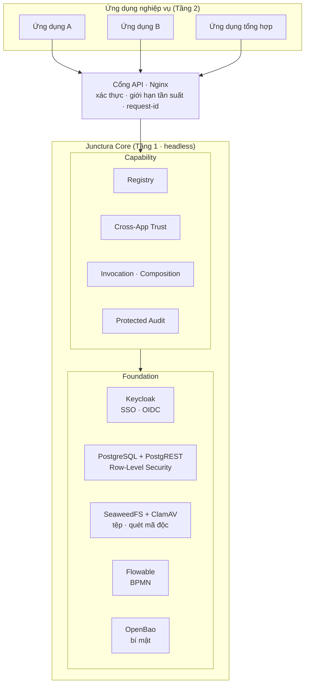
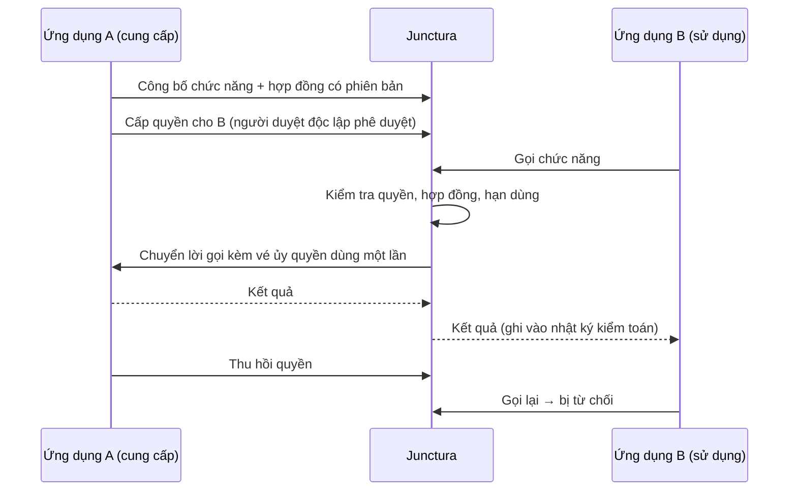

<!-- SPDX-FileCopyrightText: 2026 Junctura Contributors -->
<!-- SPDX-License-Identifier: Apache-2.0 -->

<div align="center">


# Junctura DX-OS

**Nền tảng lõi nguồn mở để các ứng dụng chia sẻ dữ liệu và năng lực với nhau — có cấp quyền, thu hồi và kiểm chứng.**

[](https://github.com/vku2-open-source-2026/junctura-dxos/actions/workflows/ci.yml)
[](https://github.com/vku2-open-source-2026/junctura-dxos/releases)
[](LICENSE)
[](REUSE.toml)

[Giới thiệu](#giới-thiệu) · [Kiến trúc](#kiến-trúc) · [Bắt đầu nhanh](#bắt-đầu-nhanh) · [API](#api-chính) · [Tài liệu](#tài-liệu) · [Lộ trình](#lộ-trình) · [English](docs/README_EN.md)

</div>

---

## Giới thiệu

Trong một tổ chức, mỗi phòng ban thường vận hành phần mềm riêng. Mỗi phần mềm tự xây lại đăng nhập, lưu trữ, phân quyền và quy trình duyệt; dữ liệu trở thành những ốc đảo. Khi một ứng dụng cần dữ liệu hay chức năng của ứng dụng khác, người ta lại viết thêm một kết nối riêng — khó kiểm soát ai được dùng gì, đến khi nào.

**Junctura** là tầng nền tảng dịch vụ lõi (headless PaaS) của kiến trúc DX-OS, giải quyết bài toán đó theo hai lớp:

- **Foundation** — những dịch vụ mọi ứng dụng đều cần, xây một lần và dùng chung: định danh/SSO, cổng API, dữ liệu có cấu trúc, lưu trữ tệp và động cơ quy trình.
- **Capability** — mỗi ứng dụng giữ dữ liệu và nghiệp vụ của riêng mình nhưng có thể **công bố chức năng**; ứng dụng khác **được cấp quyền** để gọi; Junctura **kiểm tra, thực thi và ghi vết** từng lần gọi; chủ sở hữu **thu hồi** bất cứ lúc nào.

> *Junctura* — tiếng Latin nghĩa là “mối nối”: nơi các ứng dụng độc lập gặp nhau.

### Ví dụ áp dụng

| Bối cảnh | Các ứng dụng độc lập | Junctura giúp gì |
| --- | --- | --- |
| **Trường đại học** | Đào tạo, Công tác sinh viên, Tài chính, Văn bản | Ứng dụng xét học bổng đọc bảng điểm, điểm rèn luyện, học phí từ ba phòng ban — mỗi lần đọc đều được cấp quyền và ghi vết — rồi gọi chức năng cấp giấy xác nhận của phòng Văn bản. |
| **Y tế** | Phòng khám, Xét nghiệm, Nhà thuốc | Bệnh nhân cấp quyền xem hồ sơ cho từng cơ sở, có hạn dùng, thu hồi được và biết ai đã truy cập. |
| **Đô thị** | Phòng cháy, Chiếu sáng, Thoát nước | Ứng dụng phản ánh hiện trường quét mã độc ảnh người dân gửi, rồi gọi chức năng “tạo phiếu sửa chữa” của đúng đơn vị. |

Mỗi ứng dụng vẫn do đơn vị của mình phát triển và sở hữu; Junctura chỉ là mối nối dùng chung, không thay thế nghiệp vụ.

## Tính năng nổi bật

**Nền tảng dùng chung**
- Đăng nhập một lần qua OIDC (Keycloak), vai trò đọc/ghi, cô lập theo tenant.
- Một cổng API duy nhất: xác thực mọi request ngay tại cổng, giới hạn tần suất, gắn request-id.
- Dữ liệu có cấu trúc với phân quyền theo từng dòng (Row-Level Security) cho từng tenant và từng ứng dụng.
- Lưu trữ tệp, mọi tệp được quét mã độc trước khi nhận.
- Quy trình nghiệp vụ BPMN, chống chạy trùng bằng idempotency key.

**Chia sẻ năng lực có kiểm soát**
- Chia sẻ từng bản ghi/tệp cho ứng dụng khác: chỉ đọc, có hạn dùng, thu hồi được.
- Danh mục năng lực (Capability Registry) với hợp đồng đầu vào/đầu ra có phiên bản.
- Cấp và thu hồi quyền giữa các ứng dụng, phê duyệt bởi người độc lập với người yêu cầu.
- **Sơ đồ tin cậy (Trust Graph)** trên Console: thấy ngay ứng dụng nào đang được dùng chức năng nào của ứng dụng nào, trạng thái và hạn dùng, thu hồi chỉ bằng một cú bấm.
- Gọi chức năng của ứng dụng khác (C4A) hoặc ghép nhiều chức năng thành một quy trình (C4B).
- Nhật ký kiểm toán được bảo vệ: ứng dụng không thể sửa hay xóa dấu vết, và mọi sự kiện được niêm phong bằng **chuỗi băm SHA-256** — sửa, xóa hay đổi thứ tự một sự kiện là bị phát hiện ngay.

**Vận hành và phát triển**
- Khởi động toàn bộ hệ thống, đăng ký ứng dụng mới, sao lưu và khôi phục — mỗi việc một lệnh.
- Nhật ký truy cập dạng JSON tại cổng API, truy vết từng request bằng request-id.
- OpenAPI 3.1 cho mọi API, Node SDK không phụ thuộc thư viện ngoài.
- Console quản trị song ngữ Việt/Anh.
- Bí mật quản lý bằng OpenBao; migration cơ sở dữ liệu có checksum chống sửa lén.

## Kiến trúc



Chỉ cổng API mở ra ngoài; mọi dịch vụ khác nằm trong mạng nội bộ. Core chạy không quyền root trên hệ thống tệp chỉ đọc.

### Một lần chia sẻ năng lực diễn ra thế nào



### Mô hình bảo mật

| Lớp | Cơ chế |
| --- | --- |
| Biên mạng | Chỉ cổng API công bố cổng ra ngoài; mọi dịch vụ khác nằm trên mạng Docker nội bộ. |
| Xác thực | Mọi request tới `/v1`, `/v2` được kiểm tra token OIDC ngay tại cổng (Nginx `auth_request`) trước khi tới Core. |
| Phân quyền | Vai trò đọc/ghi, ứng dụng phải được đăng ký và phê duyệt; quyền được xác định từ token đã xác minh, không tin header do client gửi. |
| Cô lập dữ liệu | Row-Level Security bắt buộc trong PostgreSQL theo tenant và theo ứng dụng sở hữu. |
| Phân tách nhiệm vụ | Người yêu cầu và người phê duyệt phải khác nhau cho ứng dụng, năng lực, quyền và quy trình ghép. |
| Tệp tải lên | ClamAV quét trước khi lưu; tệp nhiễm mã độc bị từ chối. |
| Bí mật | OpenBao giữ khóa và mật khẩu vận hành; không có bí mật trong mã nguồn. |
| Kiểm toán | Nhật ký được bảo vệ ở mức cơ sở dữ liệu, ứng dụng không thể sửa hay xóa; niêm phong bằng chuỗi băm SHA-256 theo tenant để phát hiện mọi can thiệp. |
| Container | Core chạy không quyền root, hệ thống tệp chỉ đọc, bỏ toàn bộ Linux capability. |

## Bắt đầu nhanh

**Yêu cầu:** Git, Node.js 24, Docker Desktop (Linux engine) với Docker Compose ≥ 2.20. Khuyến nghị RAM 16 GB (dành ≥ 8 GB cho Docker).

```sh
git clone https://github.com/vku2-open-source-2026/junctura-dxos.git
cd junctura-dxos
npm run setup        # tạo .env với mật khẩu ngẫu nhiên
npm run local:up     # build và khởi động toàn bộ hệ thống
npm run healthcheck  # kiểm tra các dịch vụ đã sẵn sàng
```

Hoặc dùng bản phát hành: tải `junctura-0.1.0.tar.gz` từ [Releases](https://github.com/vku2-open-source-2026/junctura-dxos/releases), kiểm tra bằng `sha256sum -c junctura-0.1.0.tar.gz.sha256`, giải nén (`tar -xzf junctura-0.1.0.tar.gz`), vào thư mục `junctura-0.1.0` rồi chạy ba lệnh trên từ `npm run setup`.

| Địa chỉ | Dịch vụ |
| --- | --- |
| `http://127.0.0.1:8080` | Cổng API |
| `http://127.0.0.1:3000` | Junctura Console |

Lần chạy đầu cần tải image và bộ nhận diện mã độc của ClamAV (vài phút). Gặp lỗi: `npm run doctor`. Dừng mà vẫn giữ dữ liệu: `npm run local:down`. Sao lưu: `npm run backup`; khôi phục: `npm run restore -- backups/<thời-điểm> --yes` (xem [Vận hành](docs/OPERATIONS.md#backup-and-restore)).

### Đăng ký ứng dụng đầu tiên

```sh
npm run app:enroll -- daotao --display-name "Phòng Đào tạo"
```

Lệnh tạo tài khoản dịch vụ cho ứng dụng, đăng ký và phê duyệt nó (người duyệt độc lập với người đăng ký), rồi ghi thông tin đăng nhập riêng của ứng dụng vào `.env.app.daotao.local`.

### Gọi API từ ứng dụng

```js
import { createJuncturaClient } from "./sdk/node/index.mjs";

const junctura = createJuncturaClient({
  baseUrl: process.env.JUNCTURA_URL,
  clientId: process.env.JUNCTURA_APP_CLIENT_ID,
  clientSecret: process.env.JUNCTURA_APP_CLIENT_SECRET,
});

const record = await junctura.createRecord("students", { name: "Nguyễn Văn A" });
const same = await junctura.getRecord("students", record.id);
```

Ứng dụng viết bằng ngôn ngữ nào cũng tích hợp được qua HTTP + JSON + OIDC; SDK chỉ là lựa chọn tiện lợi cho Node.js.

### Lệnh thường dùng

| Lệnh | Tác dụng |
| --- | --- |
| `npm run setup` | Tạo `.env` với mật khẩu ngẫu nhiên (chỉ chạy một lần) |
| `npm run local:up` / `local:down` / `local:status` | Khởi động, dừng (giữ dữ liệu), xem trạng thái hệ thống |
| `npm run healthcheck` · `npm run doctor` | Kiểm tra sẵn sàng · chẩn đoán lỗi cấu hình |
| `npm run app:enroll -- <tên>` | Đăng ký và phê duyệt một ứng dụng mới |
| `npm run trust:demo` · `-- token` | Tạo dữ liệu demo cho sơ đồ tin cậy (4 ứng dụng, 3 chức năng, 5 quyền) · in token người duyệt cho Console |
| `npm run audit:demo` · `-- tamper` · `-- restore` | Demo kiểm tra toàn vẹn nhật ký: kiểm tra, sửa lén một sự kiện, khôi phục |
| `npm run provider:pki -- <tên>…` | Tạo CA và chứng chỉ TLS cho dịch vụ cung cấp năng lực chạy nội bộ (Tầng 2) |
| `npm run backup` · `npm run restore -- <thư-mục> --yes` | Sao lưu · khôi phục toàn bộ dữ liệu |
| `npm run console` | Chạy Console ở chế độ phát triển |
| `npm test` · `npm run test:integration` | Kiểm thử đơn vị · kiểm thử tích hợp |

## API chính

Mọi API đi qua cổng `http://127.0.0.1:8080` và yêu cầu `Authorization: Bearer <token>` (trừ health và OIDC).

| Nhóm | Endpoint | Mô tả |
| --- | --- | --- |
| Định danh | `GET /v1/identity` | Danh tính đã xác minh: subject, tenant, vai trò |
| Dữ liệu | `GET·POST /v2/data/{collection}` · `GET·PATCH·DELETE /v2/data/{collection}/{id}` | Bản ghi JSON riêng của ứng dụng, cô lập bằng RLS |
| Tệp | `POST /v2/objects` · `GET·PUT·DELETE /v2/objects/{id}` | Tệp nhị phân riêng của ứng dụng, quét mã độc khi tải lên |
| Chia sẻ | `POST /v2/resource-shares` · `DELETE /v2/resource-shares/{id}` | Chia sẻ một bản ghi/tệp cho ứng dụng khác, có hạn dùng |
| Quy trình | `GET /v1/workflows/definitions` · `POST /v1/workflows/executions` | Khởi chạy, theo dõi, hoàn thành, hủy quy trình BPMN |
| Ứng dụng | `POST /v1/applications` · `POST /v1/approvals` | Đăng ký ứng dụng và phê duyệt độc lập |
| Năng lực | `GET /v1/capabilities` · `POST /v1/capabilities/{id}/versions` | Công bố và khám phá năng lực có phiên bản |
| Cấp quyền | `POST /v1/trust/grants` · `POST /v1/trust/grants/{id}/revoke` | Cấp, kích hoạt và thu hồi quyền giữa ứng dụng |
| Đồng ý của tôi | `GET`/`POST /v1/me/consents` · `POST /v1/me/consents/{id}/revoke` | Người dân cho phép ứng dụng nào được gọi chức năng nào về mình, vì mục đích gì, đến khi nào; thu hồi tức thì |
| Truy cập khẩn cấp | `GET /v1/emergency-accesses` · `POST …/{id}/review` | Danh sách truy cập khẩn cấp không cần đồng ý và hậu kiểm (cần `trust.approve`) |
| Ai đã xem dữ liệu của tôi | `GET /v1/me/data-access` | Các lần gọi năng lực có liên quan đến người đang đăng nhập: cơ sở nào, lúc nào, mục đích gì |
| Sơ đồ tin cậy | `GET /v1/trust/graph` | Ứng dụng và quyền giữa chúng, kèm trạng thái và hạn dùng (cần `trust.write` hoặc `trust.approve`) |
| Thực thi | `POST /v1/capability-executions` · `POST /v1/compositions` | Gọi một năng lực hoặc chạy quy trình ghép nhiều năng lực |
| Kiểm toán | `POST /v1/audit-events/verify` | Niêm phong và kiểm tra toàn vẹn chuỗi băm nhật ký (cần quyền `audit.read`) |

Đặc tả đầy đủ: [Foundation OpenAPI](docs/contracts/foundation-api.openapi.json) (44 thao tác) và [Capability OpenAPI](docs/contracts/capability-api-v1.openapi.json).

## Công nghệ

| Thành phần | Công nghệ |
| --- | --- |
| Định danh, SSO | Keycloak 26 |
| Cổng API | Nginx |
| Dữ liệu có cấu trúc | PostgreSQL 17, PostgREST |
| Lưu trữ tệp | SeaweedFS, ClamAV |
| Quy trình | Flowable 8 (BPMN 2.0) |
| Quản lý bí mật | OpenBao |
| Core, SDK | Node.js 24 (không phụ thuộc npm khi chạy) |
| Console | React, Vite, TypeScript |
| Đóng gói, CI | Docker Compose, GitHub Actions |

Phiên bản chính xác và giấy phép của từng thành phần: [THIRD-PARTY.md](THIRD-PARTY.md).

## Tài liệu

| | |
| --- | --- |
| [Hướng dẫn bắt đầu](docs/GETTING_STARTED.md) | Cài đặt, đăng ký ứng dụng, gọi API, SDK |
| [Kiến trúc](docs/ARCHITECTURE.md) | Ranh giới các tầng, dịch vụ và cách cô lập |
| [Core API](docs/CORE_API.md) · [OpenAPI](docs/contracts/foundation-api.openapi.json) | Route, quyền, payload, quy tắc retry |
| [Capability](docs/CAPABILITY_REGISTRY.md) | Registry, [Trust](docs/CAPABILITY_DIRECT_TRUST.md), [Invocation](docs/CAPABILITY_EXECUTION.md), [Composition](docs/CAPABILITY_COMPOSITION.md) |
| [Kiểm toán](docs/AUDIT.md) · [Bảo mật](docs/SECURITY_REVIEW.md) | Mô hình đe dọa, kết quả quét, vấn đề còn mở |
| [Vận hành](docs/OPERATIONS.md) · [Phát hành](docs/RELEASE.md) | Khởi động, migration, sao lưu, đóng gói |
| [Đối chiếu đề thi OLP'26](docs/OLP_REQUIREMENTS.md) | Yêu cầu của đề và cách Junctura đáp ứng |
| [Mục lục đầy đủ](docs/index.md) | Toàn bộ thiết kế và quyết định kiến trúc |

## Cấu trúc thư mục

```text
src/            Junctura Core: xác thực, dữ liệu, tệp, quy trình, ứng dụng, năng lực
sdk/node/       Node SDK cho ứng dụng Tầng 2
console/        Junctura Console (React, Vite, TypeScript)
infra/          Cấu hình Keycloak, Nginx, PostgreSQL (migration), SeaweedFS, Flowable, OpenBao
scripts/        Cài đặt, chẩn đoán, đăng ký ứng dụng, sao lưu, đóng gói phát hành
tests/          Kiểm thử đơn vị và hợp đồng HTTP
integration/    Kiểm thử tích hợp với dịch vụ thật
examples/       Ví dụ tích hợp qua HTTP và SDK
docs/           Kiến trúc, API, vận hành, bảo mật, đặc tả OpenAPI
```

## Kiểm thử

GitHub Actions chạy ở mỗi lần push: kiểm tra giấy phép SPDX/REUSE, kiểm thử đơn vị, build và khởi động toàn bộ hệ thống, rồi kiểm thử tích hợp với dịch vụ thật — định danh, dữ liệu, tệp, quy trình, chia sẻ năng lực, kiểm toán và khôi phục dữ liệu.

```sh
npm run check && npm test          # kiểm tra mã nguồn và kiểm thử đơn vị
npm run test:integration           # kiểm thử tích hợp
```

## Lộ trình

- [x] **v0.1.0 — Tầng 1:** Foundation, chia sẻ năng lực (Registry, Trust, Invocation, Composition), kiểm toán, sao lưu/khôi phục, CI.
- [x] Nhật ký kiểm toán niêm phong bằng chuỗi băm SHA-256, kiểm tra toàn vẹn ngay trên Console.
- [x] Sơ đồ tin cậy (Trust Graph) giữa các ứng dụng trên Console, thu hồi quyền ngay trên sơ đồ.
- [ ] **v0.2.0 — Tầng 2:** các ứng dụng minh họa thuộc không gian H-P-D-I, chia sẻ dữ liệu và năng lực qua Junctura.
- [ ] Giám sát hệ thống (Prometheus, Grafana) và triển khai thử nghiệm trên Internet.

## Đóng góp

Mọi đóng góp đều được hoan nghênh. Báo lỗi và đề xuất tại [Issues](https://github.com/vku2-open-source-2026/junctura-dxos/issues); trước khi gửi Pull Request, đọc [hướng dẫn phát triển](docs/DEVELOPING.md). Commit theo chuẩn Conventional Commits và không bao giờ commit tệp `.env` hay khóa bí mật. Lịch sử thay đổi: [CHANGELOG.md](CHANGELOG.md).

## Giấy phép

Junctura là phần mềm tự do, phát hành theo [Apache License 2.0](LICENSE), một giấy phép nguồn mở được OSI phê chuẩn — Copyright 2026 Junctura Contributors. Bạn được dùng, sửa đổi và phân phối lại (kể cả cho mục đích thương mại), miễn là giữ lại thông báo bản quyền và giấy phép, ghi rõ các thay đổi; giấy phép cũng cấp quyền sử dụng bằng sáng chế liên quan và không kèm bảo hành.

<!-- REUSE-IgnoreStart -->
- Mỗi tệp mã nguồn đều ghi giấy phép bằng tiêu đề [SPDX](https://spdx.dev/) (`SPDX-License-Identifier: Apache-2.0`); các tệp không chứa được chú thích (JSON, dữ liệu) được khai báo trong [REUSE.toml](REUSE.toml). Dự án tuân thủ chuẩn [REUSE 3.3](https://reuse.software/), kiểm tra bằng `reuse lint`.
<!-- REUSE-IgnoreEnd -->
- Toàn văn giấy phép: [LICENSE](LICENSE) · thông báo bản quyền: [NOTICE](NOTICE).
- Thành phần bên thứ ba giữ giấy phép riêng, đều là giấy phép nguồn mở: các dịch vụ (Keycloak, PostgreSQL, PostgREST, Nginx, SeaweedFS, ClamAV, Flowable, OpenBao) chạy như chương trình độc lập trong container chính thức, không chép hay sửa mã nguồn của chúng; thư viện đóng gói vào Console chỉ dùng MIT/ISC. Danh sách, phiên bản và nghĩa vụ tại [THIRD-PARTY.md](THIRD-PARTY.md).
