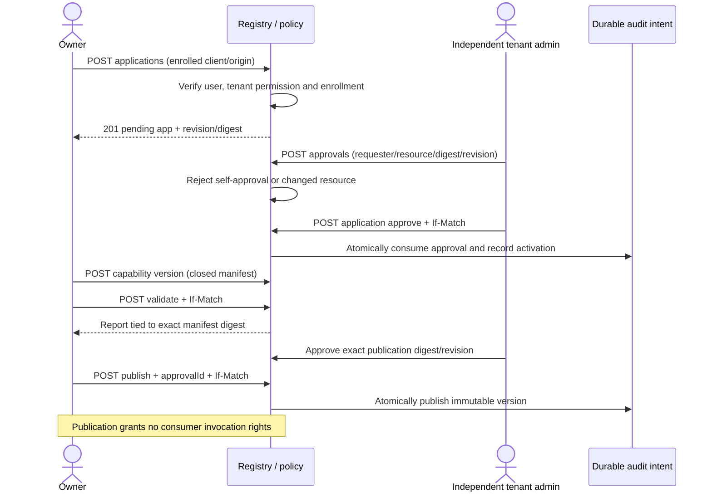
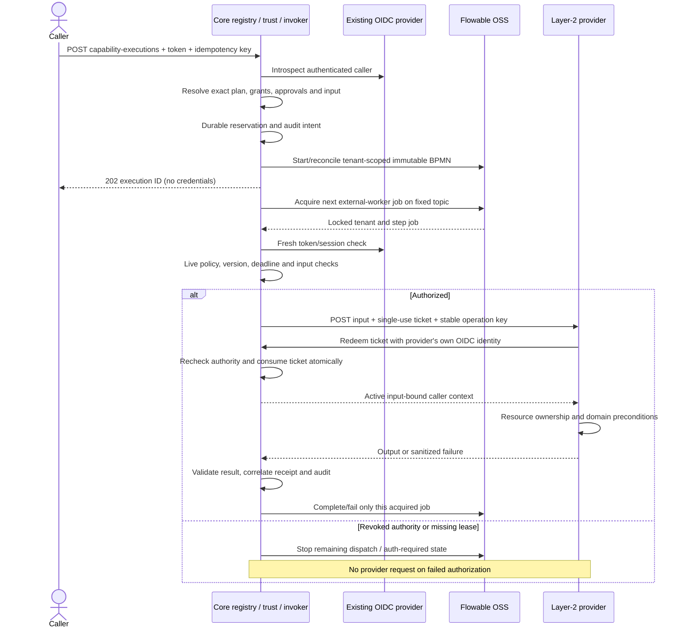

# Capability trust, composition and execution v1

Implementation update: [runtime review and application subset](CAPABILITY_RUNTIME_REVIEW_V1.md) supersedes the original design-only status for Application Registration and application-only approvals. All other extension runtimes remain unimplemented.

Status: **design draft, not implemented**. Read [the manifest/lifecycle specification](CAPABILITY_EXTENSIONS_V1.md) first. Structural request/response models are in the [OpenAPI draft](contracts/capability-api-v1.openapi.json). All examples are synthetic technical fixtures. None of these routes is added to the current server by this task.

## Identity, caller context and authority

Continue to validate the existing issuer, `rosetta-core` audience, expiry/active status, authoritative tenant membership and baseline reader/writer roles. New GET operations require `core-reader`; new mutations require `core-writer` as well. These baseline roles are necessary but never sufficient for ownership, administration, publication or invocation rights.

Proposed context is server-derived: `tenantId`, `issuer`, effective `subject`, `actorAppId`, initiating `subject`/app, principal type, internal executor identity, exact capability/version/digest, invocation/step IDs, permission set, grant/approval/delegation IDs, input digest and deadline. Do not accept context, tenant, role, permission or subject overrides in invocation bodies or `X-*` headers. Provider context is obtained through a short-lived Core authorization ticket, not unsigned propagated identity headers.

The future identity adapter must retain authenticated introspection `client_id` and map `(tenant, issuer, client_id)` to an approved app. The existing `createAuthorizer` returns only subject/tenant/roles and does not implement this binding. Do not infer `appId` from `sub`, email, a body field or an unverified token. No automatic `azp` fallback. Missing/ambiguous binding fails closed. The operator enrolls exact service-account subjects; every other allowed principal is treated as a user only after provider verification. Caller-controlled `principalType` is prohibited.

Platform management permissions (`applications.register`, `applications.approve`, `capabilities.write`, `capabilities.publish`, `trust.write`, `trust.approve`, `compositions.write`, `compositions.publish`, `audit.read`) are tenant-scoped administrative assignments provisioned outside user-writable Core data. Bootstrap is operator-controlled. No default tenant account or current `core-writer` receives these permissions by implication. Registration/ownership and user role grants remain separate.

### Explicit grants and authorization intersection

A provider owner with `trust.write` proposes a grant to one active consumer app. A different tenant administrator approves it. Grant fields are exact capability references, operations (`discover` and/or `invoke`), provider-owned permissions, an explicit nonempty list of permitted OIDC subject IDs, expiry, `delegationAllowed` and `acceptDelegation`. No wildcards, role-name selectors, arbitrary conditions, automatic version inheritance or cross-tenant IDs are accepted in v1. Subject existence and tenant membership must be verified; the issuer is the configured issuer, not a body parameter. The example grants use synthetic subject IDs.

A direct request requires the intersection of: authenticated baseline authority; active app/client binding; same tenant; appropriate owner/management permission or consumer grant; exact version/digest/state; explicit subject membership and all required permissions; current approval where required; platform preconditions. Discovery is metadata visibility only. Invocation still requires an `invoke` grant even after discovery or publication. An app invoking its own capability has no implicit bypass.

A grant starts `pending`, becomes `active` only through atomic approval, then expires or is terminally revoked. Denied approval leaves the proposal pending without authority; the owner/admin may revoke the proposal. Authority increases require a new grant/approval; only revocation is an in-place reduction. App/subject removal, expiry or grant revocation blocks subsequent dispatch. Revocations are checked against authoritative state at each dispatch/redemption, with no positive authorization cache spanning steps. A concurrent provider side effect already begun cannot be undone by revocation.

### Delegation v1

Delegation is optional, explicit, same-tenant, subject-preserving and one hop. A directly authenticated human user may create a delegation to one enrolled receiver app for exact capabilities/permissions already granted to that user and initiating app. The source grant must allow delegation; the receiving app must have an active grant accepting delegated invocation for that same subject and permission subset. A service account cannot manufacture a human subject. A delegated caller cannot redelegate. No impersonation, recursive chains, refresh token, unattended run or bearer-token forwarding is defined.

`POST /v1/delegations` accepts `receiverAppId`, capability references, permissions and `ttlSeconds` 1..300. The server fixes subject/issuer/initiating app/tenant from the authenticated caller, caps expiry at the caller token and grants' expiries, and returns an opaque record ID. It is not a transferable bearer token: only the enrolled receiver service-account subject can use it with its own current OIDC authentication. The original human caller token is retained only in the bounded memory lease described below; its loss/expiry blocks delegated work until that human reauthenticates. Revocation by the subject, originating app owner or tenant administrator is immediate for future checks. No delegation can broaden grants or replace an approval.

At dispatch, effective authority is the direct intersection above plus both applicable grants, receiver binding, delegated subject, exact delegation scope/expiry and the original user's active authorization lease. Provider context preserves the user as subject and identifies the receiver app as actor and Core as executor. Internal execution on Flowable is not permission for a second application delegation hop. [OAuth token exchange RFC 8693](https://www.rfc-editor.org/rfc/rfc8693) informs the distinction between actor and subject; this design does not claim to implement that protocol or mint exchanged OIDC tokens.

### Fixed administrative approvals

Approvals are records, not a second workflow language. A different tenant administrator issues `POST /v1/approvals` for a resource type/ID, immutable digest, revision, requester subject/app, decision and expiry. Invocation approvals additionally bind the input digest. Control-plane resource digests are server-calculated from the pending resource; an administrator cannot approve an unrelated tenant or a revision that is not current. Requester and approver cannot be the same principal. Denial records grant no authority.

Application/grant approval, capability/composition publication and an invocation with `preconditions.approval=tenant-admin` require the matching approval. For execution approval, resource ID is the target capability/composition ID and digest identifies the exact target plus logical request/context; approval is consumed once into one execution. Consumption and state mutation/reservation are atomic. Runtime checks still require the consumed approval to belong to this execution, remain unexpired and not be revoked. A retry of the same idempotent start returns its existing execution without consuming approval again, after reauthorization. No approval bypasses a missing permission or a revoked manifest. Business-specific approver selection and decisions remain Layer 2.

## Composition representation and Flowable boundary

The [composition schema](contracts/composition-v1.schema.json) defines `compositionFormat`, display name, exact version, input/output schema, immutable end-to-end `deadlineMs` (100..60000), and 1..16 ordered steps. Each step has a unique `stepId`, exact capability ID/version/manifest digest, and one whole-value binding. The first binds `composition-input`; each later step binds only its immediately preceding step's output. The returned composition output is its final step's output. There are no literals, field projections, templates, URL targets, expressions, branches, loops, parallelism or user-supplied BPMN.

Validation resolves all pinned versions in the same tenant and visible to the caller, checks schema subset rules, all grant/precondition requirements, unique/linear bindings, size/depth bounds and time budget. Sum of provider attempt budgets plus bounded retry/backoff allowance must fit the declared deadline; queue/authorization overhead can still consume that deadline and cause a safe stop. A valid structural report is tied to plan digest, manifest digests and policy revision. No stale report grants execution authority; authorization is reevaluated at publication, start and every step. Plan creation/versioning/publication uses the same draft-validation-separate-approval pattern as capabilities. No auto-upgrade to a newer capability version.

A future compiler maps the validated ordered plan to a tenant-specific immutable BPMN definition containing reviewed Flowable external-worker tasks, timer/error boundaries and engine-owned transitions. Topic is fixed by the operator, not the caller. The generic invoker may acquire one job, authorize one step, call one provider, validate one result and report completion/failure. It MUST NOT implement its own queue, dependency scheduler, timers, durable execution state machine or retry loop beside Flowable. Flowable owns those mechanics and process/history state. Registry/authorization/idempotency records correlate engine jobs and protect side effects; they do not replace the engine.

Flowable OSS documents [external worker tasks](https://www.flowable.com/open-source/docs/bpmn/ch07b-BPMN-Constructs/) and its [8.0.0 worker API](https://www.flowable.com/open-source/docs/all-javadocs/org/flowable/job/api/AcquiredExternalWorkerJob.html). The exact pinned REST image's acquire/lock/complete/fail/tenant behavior must be demonstrated before implementation approval. No enterprise-only API is assumed and no worker library is selected here. Broker/worker topics and credentials stay private. The current public `/v1/workflows` lifecycle and checkpoint remain unchanged; `/complete` must not be repurposed to bypass composition worker authorization.

### Authorization leases and provider protocol

1. Start authenticates the initiating token and creates a durable invocation reservation before dispatch. A token is held only in Core memory, never in plan, database row, Flowable variables, provider payload or audit. Lifetime is bounded by token expiry, delegation/grant/approval expiry and the immutable execution deadline. Only the configured Core executor can access this memory lease.
2. Before every attempt, introspect the initiating token (and the current receiver token for delegated work), reevaluate authoritative app/grant/delegation/approval/version state and validate actual input. If the lease is lost, enter `auth_required` without dispatch. Resume requires fresh authentication of the original issuer/subject/initiating app; delegated work requires reauthentication of the original human as well. The original deadline continues to run and cannot be extended by resume. A reauth request is not a new authority grant.
3. Create a cryptographically secure random 256-bit opaque ticket bound to provider app, capability digest, tenant, invocation/step/attempt, JCS input digest and effective context. Store only its hash outside memory. Its lifetime is at most 30 seconds and never exceeds any authority/deadline bound. Provider call is POST to the enrolled origin/path, `Authorization: Bearer <ticket>`, `Idempotency-Key: <stable invocation UUID>`, JSON `{invocationId, capability, input}`. The raw caller token is never forwarded.
4. The provider authenticates to Core with its own enrolled OIDC service account and redeems the ticket via `/v1/capability-authorizations/introspect`, supplying ticket, invocation ID and actual input digest. Core reauthorizes again and atomically consumes the ticket. Only the pinned provider can redeem it. Invalid/expired/replayed/wrong-provider tickets return only `{active:false}`; no foreign caller context is exposed. A true response includes the authoritative context and expiry. The provider checks the digest/reference/tenant before executing Layer-2 logic and resource ownership checks.
5. Provider success is HTTP 200 `{output: <JSON value>}`. A non-success is a sanitized typed failure; Core must not mirror arbitrary provider bodies/stack traces. Validate actual output schema and 64 KiB limit before making it available to the next step. An invalid output after a mutation may indicate an unknown/partial effect, not proof of rollback.

In v1 the Core executor is single-owner for a memory lease. Restart/failover loses the lease; availability and reauthentication requirements are explicit. Durable Flowable state survives, but unattended recovery is not promised. IdP introspection controls token/session activity according to provider semantics; immediate realm-role changes are not assumed. Cross-app policy revocations are authoritative Core records and checked live. Credential storage/refresh, HA and long-running execution need a separately approved design.

## Failures, retry and idempotency

Execution states exposed by the proposed adapter are `accepted`, `running`, `auth_required`, `succeeded`, `failed`, `cancelled`, `timed_out` or `outcome_unknown`, derived from Flowable plus correlated authorization/dispatch records. Unknown effects take precedence over a clean timeout/cancelled label. Terminal results never imply rollback. Revocation prevents remaining dispatch but cannot retract an in-flight request or committed effect. Stop/cancel closes the authorization lease and invalidates outstanding tickets; a late result is recorded as such rather than silently treated as a new success.

- Create invocation/execution requires a UUID `Idempotency-Key`. Unique reservation is tenant + issuer + initiating subject + actor app + route/target + key. Fingerprint covers exact target/plan digest, canonical input and delegation record ID; auth tokens and approval IDs are excluded. A changed logical request returns `409 idempotency_conflict`.
- Reauthenticate and reauthorize before returning an existing result. Same input/key returns the existing record (`200`); a new durable accepted record returns `202` with Location. Database reservation commits before starting Flowable; its tenant-scoped business key reconciles an ambiguous engine start. If no unique engine outcome is established, return `409 execution_pending_reconciliation` and never start again blindly. Use a new extension ledger, not the existing workflow ledger namespace.
- Stable provider operation key is a persisted UUID assigned to one logical step invocation, unchanged across worker redelivery/attempts. Acquire engine locks and correlate records, but assume at-least-once job delivery. Lock expiry is not evidence that no provider effect occurred.
- `sideEffects=none`: up to 3 total attempts for a definite transient connection/503/429 failure, reauthorized each time, within the end-to-end deadline. Flowable schedules 100/200 ms backoff, honoring a larger provider Retry-After only if it fits. No retry on invalid input/output or authorization failure.
- `idempotent`: replay only when provider idempotency behavior is certified, durable key/result retention covers the replay window, and the exact same key/input is used. Maximum 3 attempts as above. A lost provider guarantee or ambiguous result remains `outcome_unknown` until authenticated provider/operator reconciliation; never substitute a fresh key.
- `non-idempotent`: dispatch once. A response lost after possible receipt, timeout, crash after dispatch or uncertain cancellation is `outcome_unknown`; no automatic replay or automatic compensation. Record explicit provider reconciliation evidence before resolving it.
- Denied/revoked authority returns `403`, hidden/foreign resources `404`, malformed JSON `400`, structurally/semantically invalid contracts `422`, missing/conflicting approval/pending reconciliation `409`, oversized body `413`, wrong media type `415`, stale revision `412`, missing required revision `428`, bounded capacity `429`, unavailable identity/policy/audit storage `503`. Responses contain sanitized codes, not secret values.

Reservations, deduplication tombstones and required engine/provider history must survive the supported replay window. Propose a minimum 24-hour replay window, declared to clients; after result-body expiry, retain a key/target/input-hash tombstone and return `409 result_expired`, not a new dispatch. Purging those tombstones is an operator-approved retention decision, never automatic permission to reuse an old key. No claim of exactly-once business effects or distributed transaction across providers is made.

## Audit events

Append immutable, tenant-scoped events for `application.registered/approved/suspended/revoked`, `capability.registered/validated/published/deprecated/revoked`, `grant.proposed/activated/revoked`, `delegation.created/revoked/expired`, `approval.decided/consumed/revoked`, `composition.validated/published`, `execution.accepted/reauthorized/auth_required/completed/failed/cancelled`, `invocation.dispatched/reconciled/outcome_unknown` and `authorization.denied`.

Each event has UUID, UTC timestamp, tenant, request/correlation/execution/step IDs where applicable, actor app and issuer/subject, effective subject, resource ID/version/digests, decision/reason code, relevant authority-record revisions and outcome. No tokens, tickets, secrets, full inputs/outputs or arbitrary provider error text. Payload digests themselves may be sensitive and remain access-controlled. Tenant auditors need `audit.read`; app owners see only their authorized resources and callers only their own permitted executions. Foreign audit objects return 404.

Persist an audit intent and reservation/state change atomically before a mutating dispatch; a crash-safe outbox may deliver the event to audit storage. Failure to durably record intent means no dispatch. Result/audit persistence failure after a possible effect means `outcome_unknown`, never an unaudited blind retry. Audit append-only here is a required access/transaction policy, not a claim of cryptographic tamper-proof storage or completed implementation. Retention and incident access need operator approval.

## Sequence: registration, validation and publication

## Sequence: composition execution and runtime denial

The diagrams describe proposed responsibilities, not implemented network calls. Engine IDs, provider URLs and administrative credentials are not returned to public clients. The Flowable adapter must reject forged job IDs, mismatched tenant/step bindings and stale locks rather than trusting job variables as authority.

## HTTP and OpenAPI conventions

The [OpenAPI 3.1.1 document](contracts/capability-api-v1.openapi.json) is design-only. Its server is a reserved `.invalid` documentation hostname; no demo/deployment is implied. It describes only new extension routes, not a replacement specification for current `/health`, `/ready`, `/v1/identity`, data/object/workflow routes. Existing errors such as `{error: code}` are preserved. New errors keep `error` as a code string, adding `requestId` and optional sanitized JSON-Pointer `details`.

- Resource routes are `/v1/applications`, `/v1/capabilities`, `/v1/trust/grants`, `/v1/approvals`, `/v1/delegations`, `/v1/compositions`, `/v1/capability-executions`, provider ticket redemption and `/v1/audit-events`. Exact methods, body models and status responses are in OpenAPI. Every endpoint is authenticated; admin permission annotations are additional requirements, not OAuth scopes claimed from client input.
- JSON request fields use camelCase; IDs are opaque strings, not numeric identifiers. UUIDs are lowercase; capability/permission URNs and exact versions are percent-encoded as path segments by HTTP libraries. Payload property spelling is preserved; no automatic Python snake_case/TypeScript camelCase conversion of user schemas or values.
- Use JSON Schema 2020-12 through OpenAPI 3.1.1. Avoid OpenAPI 3.0 `nullable`; optional fields are omitted, and explicit null is valid only where the payload schema allows it. Use discriminated unions for execution targets and single JSON values for input/output. Do not put tokens in URLs.
- Requests reject unknown properties and duplicate keys. Clients must tolerate unknown response fields and unknown future error codes, preserve exact string IDs/digests and enforce documented input schemas. Permission/profile extensions that change authority or assertion semantics require a reviewed version change.
- UTC RFC 3339 timestamps end in `Z`. No int64 identifiers or arbitrary-precision numeric promises; exact decimal/big integer values use application-declared strings. JCS is an explicit server/contract function, not a client's ordinary `JSON.stringify`/`json.dumps` promise.
- Limit JSON bodies to 64 KiB, schema/value depth to 32 and lists to `limit=1..100` (default 100). Cursor is opaque, bounded, tenant/caller/filter-bound and integrity-protected. Reauthorize every page; do not expose total counts or hidden/foreign IDs through discovery. Clients must deduplicate if concurrent publication changes pagination.
- GET returns `200`; new control resources `201`; accepted execution `202` with Location, authorized execution replay `200`. Mutating resource transitions and draft PUT require ETag/If-Match. GET reports ETag; JSON integer revision is supporting metadata, not a substitute for the exact opaque header. Unsupported query parameters are rejected.
- `Idempotency-Key` is mandatory only for execution creation in this draft. Do not automatically retry arbitrary POST, approval or state-transition operations from a generated client. Honor Retry-After on 429/503 only when the operation's retry contract permits it and the deadline remains valid.
- App and grant proposal digests hash JCS `{resourceId,tenantId,proposal}`. App `proposal` is `{displayName,oauthClientId,providerOrigin,ownerSubject}`; grant proposal is its complete GrantCreate body. Manifest/plan digests hash their complete document. `resourceRevision` is bound separately by approval. Execution-request approvals hash `{target,inputDigest,issuer,subject,actorAppId,delegationId}` with absent delegation represented as null; tokens and approval ID are excluded. `inputDigest` is JCS of the actual JSON input.
- Draft client conformance must verify Python/TypeScript serialization, null/omission behavior, error handling, URI encoding, large-integer rejection, schema `$ref` packaging and pagination. No SDK is generated or required by this task.

`POST /v1/delegations/{delegationId}/reauthorize` is performed by the original human subject through the original initiating app. It renews memory proof only within the existing delegation expiry and scope; it cannot reactivate a revoked/expired delegation. A receiver resumes the correlated execution under its own fresh service-account token after this human proof exists. Direct executions resume only under their original principal/app. Both operations remain bounded by the original execution deadline.

Provider failure envelope is `{error,effect}` as typed in OpenAPI; `effect` is `none`, `committed` or `unknown`. It is provider-supplied evidence, not automatic permission to retry. Unknown/invalid results from potentially mutating work require reconciliation. Result-body retention, audit retention, network enrollment, administrator assignments and permitted subject verification are operator-owned policies to approve before implementation.

### Explicit residual boundaries

Operator-enrolled management clients and administrative assignments bootstrap registration; the first application does not self-assign authority. Every grant capability/permission must belong to its declared provider and approved exact version; consumer/subject IDs are validated in the same tenant. Grant permissions cannot exceed the union of declared permissions of its pinned capabilities.

A redeemed provider ticket proves an authorization decision at a particular instant, not an atomic transaction with a remote business commit. Providers must reject an expired deadline before beginning an effect. Revocation after redemption cannot guarantee a zero-window remote stop; in-flight/partial effects require evidence and reconciliation. This race and the availability limit of memory-only authorization leases require explicit acceptance before implementation.

Validation endpoints return HTTP 200 with a report whose status may be valid, invalid or indeterminate. Malformed validation requests still fail normally. Only a current valid report can support publication; a report is not an authorization cache or an execution grant.

Provider deduplication keys are scoped by tenant, provider app, capability/version and logical invocation ID. A duplicate key with a different input digest must be rejected. v1 control-plane app ownership uses verified human membership; provider automation must not acquire ownership or approval authority merely by possessing an app service-account credential. Tenant-admin approvals require a human principal and must exclude both the proposer and the resource app owner.
