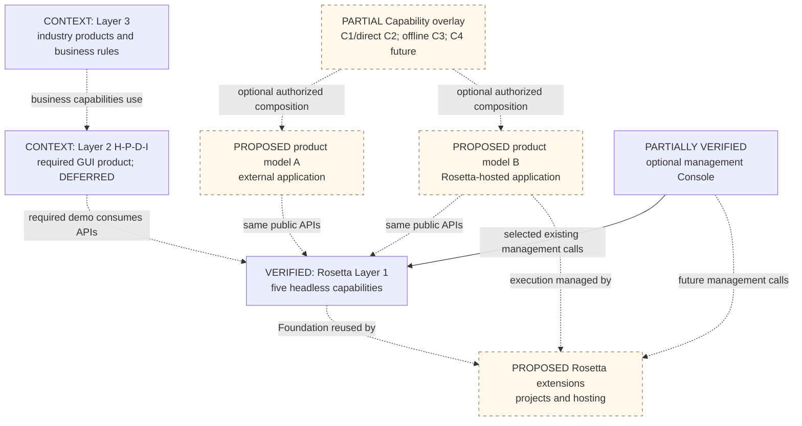
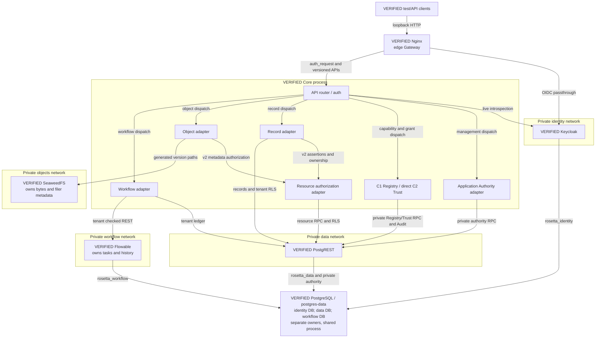
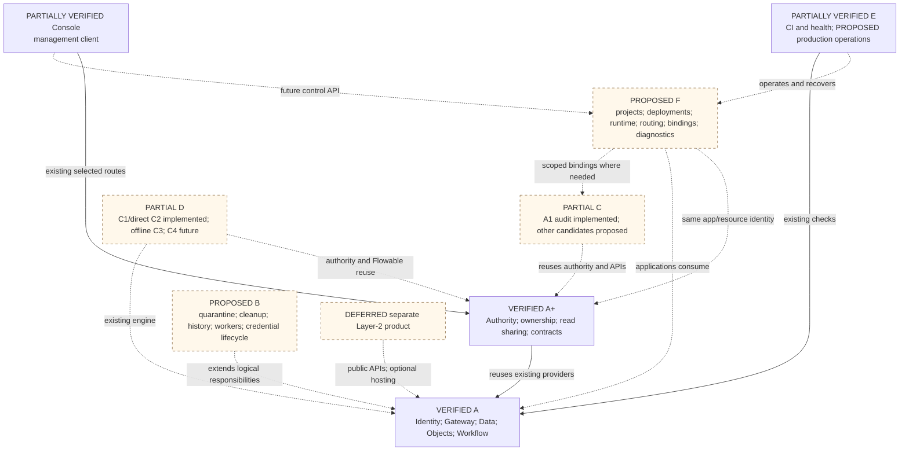
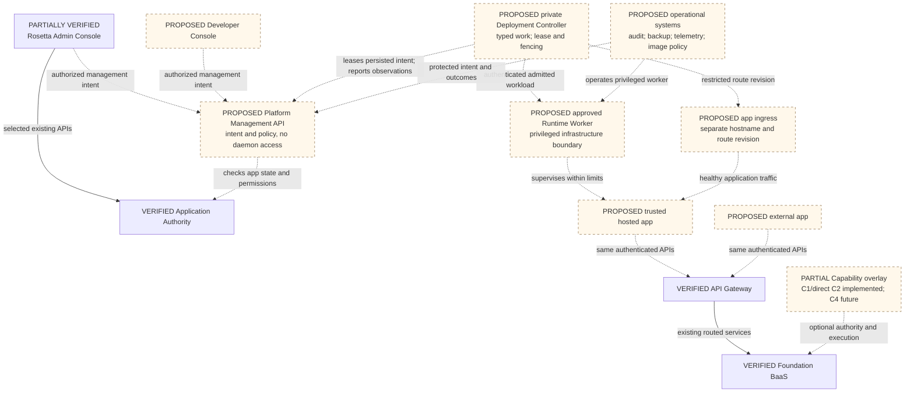
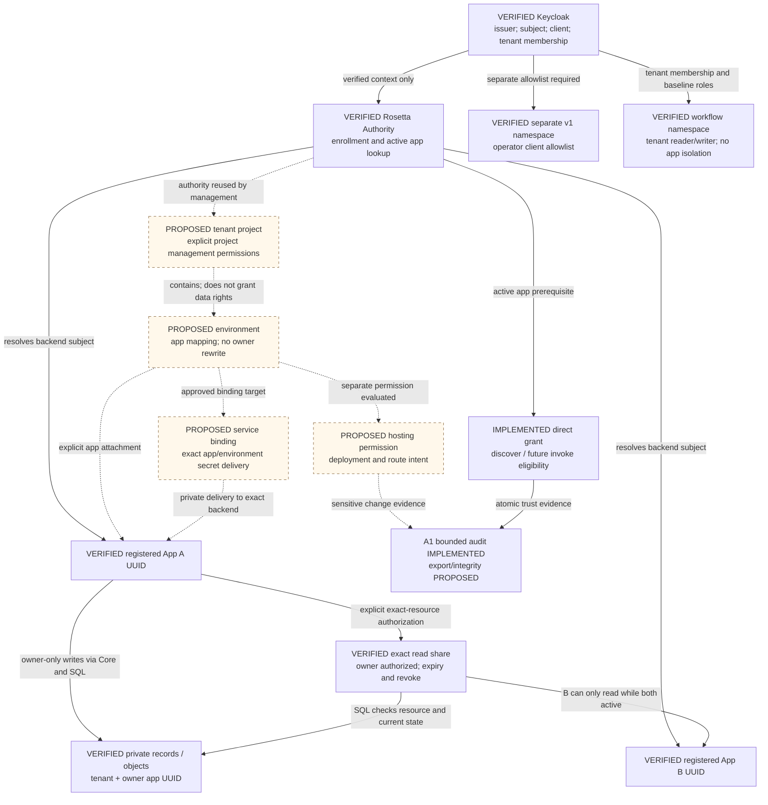
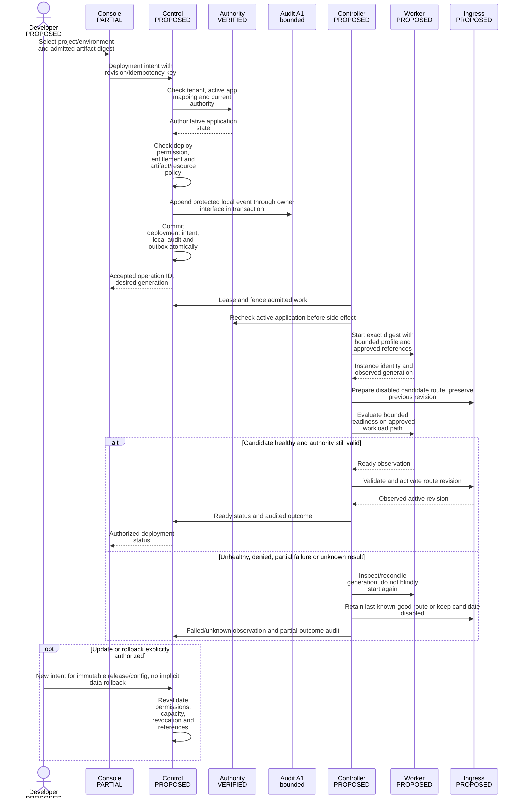
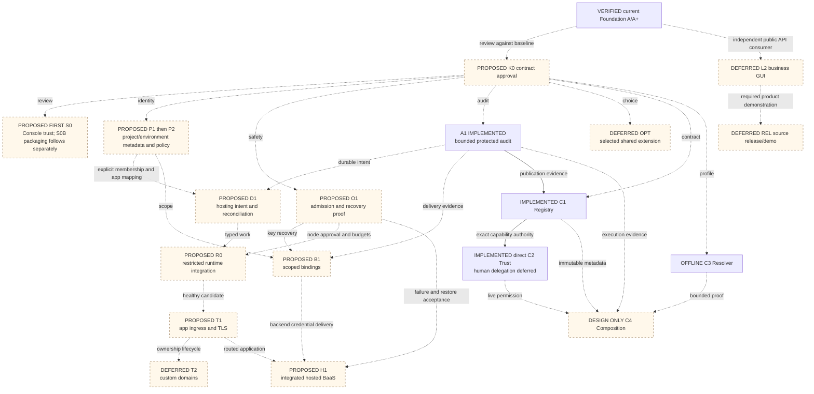
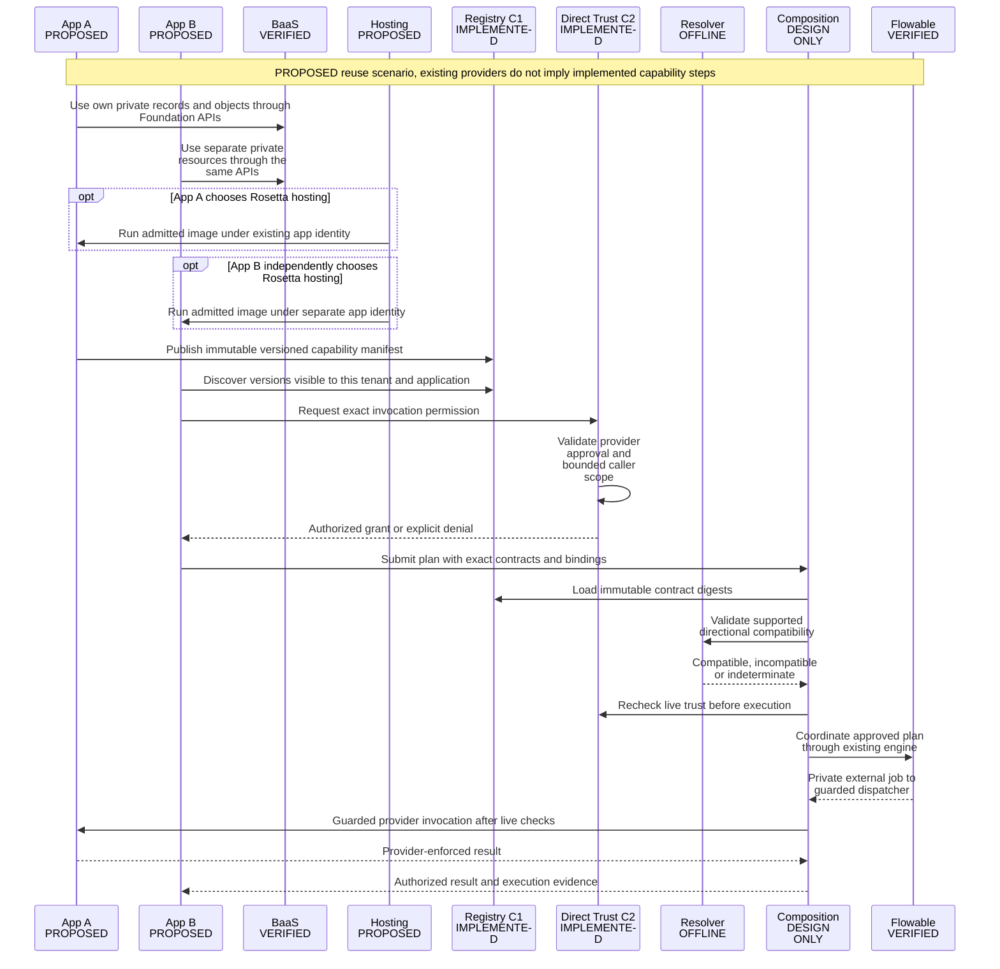

# Editable architecture maps

> Reviewed: 2026-10-26 | Branch: main | Audit baseline: `7fdd7fc381bdd29d81d56fb08a764efff8c41582`

Legend: **VERIFIED** means the bounded source/test evidence in the
[catalog](LAYER1_CORE_CATALOG.md), not live production. In flowcharts, solid arrows represent
current integrations; dashed arrows and outlined PROPOSED/DESIGN ONLY nodes
represent future relationships. Sequence arrows describe proposed interactions;
participant labels and captions identify the current providers. CONTEXT identifies official conceptual layers,
not running components. PARTIALLY VERIFIED identifies Console/operations limits.
All eight diagrams are editable Mermaid; they do not authorize implementation.

Current update (2026-10-29): C1 Registry, bounded direct C2 Trust/discovery and
A1 Audit are implemented; C3 is offline. Human delegation and C4 execution are
unimplemented. See [direct Trust](../CAPABILITY_DIRECT_TRUST.md) for scope/evidence.

## MAP 01: Competition and product context

Official context is traced in [the requirement matrix](OLP_REQUIREMENT_TRACEABILITY.md).
Hosting and composition are Rosetta extensions. Console is not the required
business GUI. Business schemas/decisions remain in L2/L3 even when hosted by Rosetta.

## MAP 02: Current implemented architecture

The PostgreSQL container joins identity/data/workflow networks; it is one shared
failure domain. SeaweedFS persists to `object-data`. The optional Console profile
is not included as a verified runtime integration here: only selected calls and
preview tests are established. Private provider ports are not published; broad
Keycloak passthrough still needs an Internet-exposure review.

## MAP 03: Target logical Core taxonomy

Group C is a candidate catalog; F does not depend on every C service. A narrow
secret/binding and protected-audit contract may be needed before hosting enablement.
Group letters and F modules are not container counts or new competition minimums.

## MAP 04: Control, data, runtime and operational planes

Control/data/worker interfaces are distinct even on one VPS. Consoles never
connect to WK, Docker sockets or provider credentials. Capability overlay is not
on the ordinary BaaS/hosting request path. Operational host access remains trusted.

## MAP 05: Resource ownership and trust

Project/deployment rights never imply v2 reads. Domain authorization belongs in
the Layer-2 backend; a browser does not become App A by submitting its UUID.
Resource shares and Capability grants have separate contracts and authorities.

## MAP 06: Proposed deployment lifecycle

Every hosting step below is PROPOSED; the Authority participant reuses existing
registration truth. There is no running deployment feature represented here.

The controller may itself be unavailable; ongoing healthy workloads must not
depend on browser or per-request controller availability. [Failure table](DEPLOYMENT_MODEL.md#failure-contract)
defines the remaining target obligations.

## MAP 07: Dependency and implementation DAG

This is an acyclic prerequisite graph, not a progress chart. Metadata needs no
controller; Resolver profile tests need no hosting/registry runtime; Layer-2
delivery need not wait for hosting, optional shared services or Capability Runtime.
The [expanded edge register](IMPLEMENTATION_DEPENDENCIES.md#canonical-dependency-edges)
is the implementation ordering reference.

## MAP 08: Cross-application reuse vision

Foundation/Flowable, C1 publication and bounded direct C2 grants/discovery are
current integrations. The complete sequence above remains a future composition
scenario: resolver HTTP routes, provider dispatch and C4 coordination do not
exist. The compatibility module is offline only. Application business decisions remain in
A/B. Hosting changes execution location; BaaS supplies reusable infrastructure;
Capability Composition supplies optional authorized reuse.
